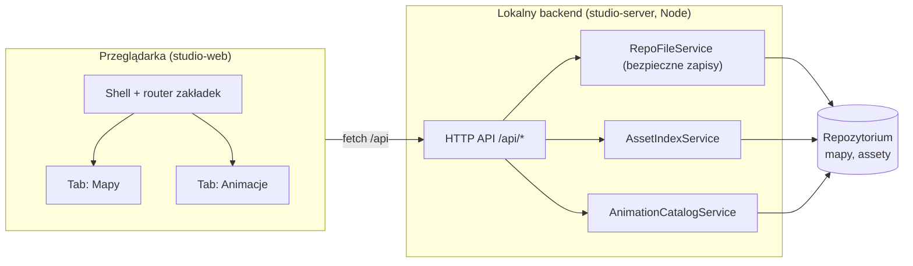

# Urkaaaz Studio — architektura

Status: **plan uzgodniony z użytkownikiem (decyzje z sekcji 14)**. Zaimplementowany
jest krok 1 planu (szkielet w `studio/`, patrz `studio/README.md`); reszta nie
jest jeszcze zaimplementowana. Studio to lokalne narzędzie deweloperskie,
nie część gry.

Zakres pierwszych wersji: zakładki **Animacje** i **Mapy**. Zakładki
**Kampania** i **Balans** są odroczone (sekcje 10 i 11 zachowują szkic na
później).

## 1. Cel i zakres

Urkaaaz Studio to jedna aplikacja webowa z zakładkami, która zastępuje
rozproszone narzędzia pomocnicze:

| Zakładka | Rola | Stan wyjściowy |
|---|---|---|
| Mapy | edycja `MapDefinition` JSON (teren, fundamenty, dekoracje, relikty) | istniejący `map-editor-web` |
| Kampania / poziomy | przegląd poziomów i kamieni milowych | **odroczone** |
| Balans | edycja parametrów silnika, uruchamianie symulacji, raporty | **odroczone** (`game-balance` na niescalonej gałęzi `feature/balance-simulation`) |
| Wizualizator animacji | podgląd istniejących animacji | do zbudowania |

Poza zakresem (na teraz): uwierzytelnianie, praca wielu użytkowników, hosting,
generowanie nowych grafik, edycja kodu gry, wbudowywanie Studio w APK.

Zasady nadrzędne:

1. Studio **nie jest źródłem prawdy** — źródłem są pliki repozytorium. Studio
   je czyta, waliduje i zapisuje.
2. Studio nie zawiera reguł gry poza walidacją kontraktu mapy w TypeScript
   (sekcja 6). Autorytatywny pozostaje walidator Kotlin, sprawdzany w testach.
3. Studio nie importuje kodu Androida i nie jest zależnością żadnego modułu
   gry (kierunek zależności: Studio → repozytorium/CLI, nigdy odwrotnie).
4. Nie wprowadzamy drugiego, równoległego kontraktu terenu, assetów ani
   nawigacji — Studio korzysta z istniejących.

## 2. Architektura wysokiego poziomu



Odroczone zakładki Kampania i Balans dołożą później m.in. `JobRunner`
(uruchamianie Gradle) i własne routery API.

- **`studio-web`** — React/Vite (ten sam stos co `map-editor-web`). Czysty
  frontend; nie dotyka systemu plików.
- **`studio-server`** — mały lokalny serwer Node/TypeScript nasłuchujący
  wyłącznie na `127.0.0.1`. Jedyny komponent z dostępem do plików i procesów.
- Hosting w przyszłości: ten sam `studio-server` można uruchomić zdalnie, ale
  wymaga to osobnej decyzji (auth, izolacja zapisu). Kontrakt API jest od
  początku projektowany tak, by to nie zmieniało frontendu.

## 3. Struktura katalogów

```text
studio/
  web/                      # frontend (React/Vite)
    src/
      shell/                # layout, router zakładek, status zapisu
      tabs/
        maps/               # dawny map-editor-web (domain, format, rendering, state)
        animations/
        # campaign/, balance/ — odroczone
      shared/               # klient API, komponenty, typy kontraktów
  server/                   # lokalny backend
    src/
      api/                  # routery per zasób
      services/             # RepoFileService, AssetIndexService, AnimationCatalogService
      contracts/            # schematy żądań/odpowiedzi (współdzielone z web)
  README.md
```

`map-editor-web` zostaje przeniesiony do `studio/web/src/tabs/maps` krokami
opisanymi w sekcji 9; do czasu migracji działa bez zmian.

## 4. Backend: kontrakty API

Wszystkie ścieżki są względne wobec korzenia repozytorium i weryfikowane po
stronie serwera (sekcja 5). Format: JSON, chyba że zaznaczono inaczej.

| Metoda i ścieżka | Opis |
|---|---|
| `GET /api/health` | wersja, korzeń repozytorium, gałąź git, czy drzewo jest czyste |
| `GET /api/maps` | lista map z `game-campaign/.../maps/` |
| `GET /api/maps/{id}` | zawartość mapy |
| `PUT /api/maps/{id}` | walidacja + zapis mapy (patrz 5 i 6) |
| `POST /api/maps/validate` | walidacja bez zapisu (walidator TypeScript, sekcja 6) |
| `GET /api/assets/terrain/index` | zunifikowany indeks assetów terenu |
| `GET /api/assets/terrain/file?path=` | plik PNG (tylko z listy dozwolonych korzeni) |
| `GET /api/animations` | katalog animacji (sekcja 8) |
| `GET /api/animations/{id}/frames/{n}` | pojedyncza klatka PNG |

Odroczone (zakładki Kampania i Balans), tylko jako szkic kontraktu:
`GET /api/campaign/levels`, `GET/PUT /api/balance/parameters`,
`POST /api/balance/runs` (zwraca `jobId`), `GET /api/jobs/{jobId}` (log, SSE).

Błędy mają stały kształt: `{ code, message, details[] }`. `details` niesie
wyniki walidacji (ścieżka pola, reguła), tak by frontend mógł je pokazać przy
elemencie.

## 5. Bezpieczny dostęp do plików

`RepoFileService` jest jedynym miejscem zapisu. Reguły:

1. **Lista dozwolonych korzeni zapisu**: wyłącznie
   `game-campaign/src/main/resources/maps/`,
   `android-app/src/main/assets/maps/`, plik(i) katalogu parametrów oraz
   pliki konfiguracji Studio. Wszystko inne jest tylko do odczytu.
2. Ścieżki są normalizowane i sprawdzane po `realpath`; odrzucamy `..`,
   dowiązania wychodzące poza korzeń i nazwy spoza wzorca `[a-z0-9_-]+`.
3. Zapis jest **atomowy**: plik tymczasowy w tym samym katalogu → `rename`.
4. Przed zapisem serwer sprawdza **hash zawartości** przesłany przez klienta
   (optymistyczna współbieżność). Rozbieżność = `409`, bo plik zmieniono poza
   Studio (np. w IDE lub przez agenta).
5. Studio **nigdy** nie wykonuje `git commit`/`push` ani nie zmienia gałęzi.
   Commit zostaje po stronie użytkownika (`/push`). `GET /api/health`
   pokazuje stan drzewa, by użytkownik widział, co zmieniło Studio.
6. Undo: poza historią w pamięci edytora (jak dziś) Studio opiera się na gicie
   (`git diff` / `git checkout` wykonuje użytkownik); osobnego magazynu kopii
   nie wprowadzamy.

### Duplikacja map

Mapy istnieją dziś w dwóch identycznych kopiach:
`game-campaign/src/main/resources/maps` i `android-app/src/main/assets/maps`.
Studio zapisuje **obie kopie jednym żądaniem** (zapis dwufazowy: oba pliki
tymczasowe, potem oba rename'y). Docelowo warto usunąć duplikat (wspólne
źródło w `game-campaign`, kopiowane przy buildzie) — decyzja użytkownika: na
razie duplikat zostaje.

## 6. Walidacja

Decyzja: walidacja mapy działa **tylko w TypeScript** (przeglądarka i serwer
współdzielą ten sam moduł). Zapis mapy: `walidacja schematu i reguł kontraktu
→ zapis`; błąd walidacji blokuje zapis. Brak wywołania Kotlina z linii poleceń.

Walidator Kotlin pozostaje autorytatywny (zgodnie z
`docs/map-editor/web/README.md`). Ryzyko rozjazdu TypeScript ↔ Kotlin
ograniczają testy: Kotlin musi akceptować każdą mapę z repozytorium zapisaną
przez Studio, a testy TypeScript używają tych samych map referencyjnych
(`game-campaign/.../maps/`). Rozjazd wykryje bramka `./gradlew test` po zapisie.

## 7. Zunifikowany indeks assetów

Obecnie istnieją dwa niezgodne indeksy: `game-assets/.../terrain/asset-index.txt`
(92 wpisy) oraz generowany `map-editor-web/public/assets/terrain/asset-index.txt`
(132 wpisy: dodatkowo relikty i detale z drawable Androida), a edytor używa też
17 plików spoza indeksu (tła, czapy, gleby, forteca, katapulta, `sunken_marshes`).

Plan:

- `AssetIndexService` buduje indeks **w locie** z dwóch źródeł:
  `game-assets/.../terrain/` oraz wybranych plików z
  `android-app/.../drawable-nodpi/` (wzorce z `sync-assets.mjs`).
- Skrypt `sync-assets.mjs` i kopiowanie do `public/assets` znikają: serwer
  serwuje pliki bezpośrednio ze źródeł. `dist/` i `public/assets/` są
  generowane i nigdy nie są źródłem prawdy.
- Do indeksu wchodzą również pliki dziś wczytywane „po cichu” (tła, czapy,
  gleby, forteca, katapulta), z jawną kategorią i biomem.
- Klucze assetów dekoracji używane w mapach pozostają bez zmian.

## 8. Zakładka: wizualizator animacji

Wizualizator **tylko odtwarza** istniejące animacje; niczego nie generuje.

### Źródło i parsowanie

Źródłem są pliki `android-app/src/main/res/drawable-nodpi/anim_*.png`, nazwane
według konwencji z `AGENTS.md`:

```text
anim_<category>_<target>_<type>[_<variant>]_<frame:3>.png
```

`AnimationCatalogService` parsuje nazwy wyrażeniem regularnym, grupuje klatki w
sekwencje i zwraca:

```text
AnimationSequence {
  id          // anim_character_orc_move_blue
  category    // character | spell | ammunition
  target      // orc, fire_rain, rock, ...
  type        // idle | move | attack | death | flight | impact | ...
  variant?    // blue | red | ...
  frameCount, firstIndex
}
```

Reguły spójności (te same co `AnimationAssetNamingTest`): indeksy klatek są
ciągłe od `000`, brak dziur i duplikatów. Sekwencje naruszające konwencję są
pokazywane w osobnej sekcji „Niezgodne z konwencją”, a nie ukrywane.

### UI

- Drzewo: **kategoria → cel → typ**; ammunition/pociski jako osobna kategoria.
- Jeden wspólny podgląd (canvas) przełączający się między animacjami wybranego
  celu; kontrolki: play/pause, klatka po klatce, FPS, tło (jasne/ciemne/siatka),
  przełącznik wariantu drużynowego.
- Pole „tylko animacje bez loadera”: oznacza sekwencje, których nie wczytuje
  `BattlefieldAssetCatalog` (dziś `anim_ammunition_fire_rain_impact`).
  Informacja pochodzi z listy w konfiguracji Studio, nie z analizy kodu.

Ta zakładka jest tylko do odczytu, więc jest najlepszym pierwszym krokiem do
wdrożenia serwera (brak ryzyka zapisu).

## 9. Zakładka: mapy (migracja `map-editor-web`)

Zmiany względem dzisiejszego edytora:

| Obszar | Dziś | W Studio |
|---|---|---|
| Wczytanie mapy | import pliku z dysku | `GET /api/maps/{id}` |
| Zapis | pobranie pliku JSON (`anchor.download`) | `PUT /api/maps/{id}` z hashem |
| Szkic | `localStorage` | `localStorage` pozostaje jako autosave; nigdy nie nadpisuje pliku |
| Indeks assetów | `fetch("/assets/terrain/asset-index.txt")` | `GET /api/assets/terrain/index` |
| Walidacja | przeglądarka + ręcznie Kotlin | wspólny moduł TypeScript (przeglądarka i serwer) przed zapisem |
| Asset sync | `scripts/sync-assets.mjs` | zbędny |

Zachowujemy bez zmian: model domenowy, kodek JSON, renderer canvas, transformy,
testy Vitest. Przeniesienie jest mechaniczne (przesunięcie katalogów +
podmiana warstwy IO), co ogranicza ryzyko regresji. Zamrożony układ
fortec/katapult z `AGENTS.md` obowiązuje bez zmian i nadal wymaga równoległej
aktualizacji symulacji, rendera Androida, podglądu w edytorze i testów.

Moduły Kotlin `map-editor-domain/-format/-rendering` (pozostałość po edytorze
desktopowym) są poza zakresem Studio; ich status należy ocenić osobno.

## 10. Zakładka: kampania i poziomy

**Odroczone** — poza pierwszymi wersjami Studio. Szkic na później, **tylko
odczyt**: lista poziomów i kamieni milowych z
`game-campaign`, powiązanie poziom → mapa, podgląd. Edycja kontraktów
kampanii wymaga osobnego projektu, bo definicje poziomów są kodem Kotlin
(`docs/architecture/level-definition-architecture.md`), a nie danymi.
Studio nie generuje kodu Kotlin w pierwszej wersji.

## 11. Zakładka: balans

**Odroczone** — poza pierwszymi wersjami Studio. Szkic na później.

Opiera się na module `game-balance` i wstrzykiwalnym katalogu parametrów
silnika (`GameBalance.kt`), obecnych na gałęzi `feature/balance-simulation`,
która **nie jest jeszcze scalona z `develop`**. Zakładka może być
zaimplementowana dopiero po scaleniu (lub na tej gałęzi).

- Odczyt/zapis parametrów przez `GET/PUT /api/balance/parameters`; serwer
  waliduje zakresy tym samym kodem Kotlin, co gra.
- Symulacje (`POST /api/balance/runs`) uruchamia `JobRunner` jako proces
  Gradle; wynik (raport z `BalanceReport`) jest strumieniowany jako log i
  zapisywany jako artefakt poza repozytorium (np. `build/studio/`).
- Zasada zachowana z wcześniejszych ustaleń: Studio nie zmienia parametrów
  po cichu — każda zmiana jest widoczna jako diff w git, a HP fortec nie jest
  obniżane bez wyraźnej decyzji użytkownika.

## 12. Uruchamianie i testy

- `npm run studio` (w korzeniu `studio/`): startuje serwer na `127.0.0.1:<port>`
  i frontend (Vite z proxy `/api`).
- Wymagania: Node (jak dziś). JDK 17 + Gradle wrapper tylko dla bramki
  walidacyjnej gry, nie dla działania Studio.
- Testy: Vitest dla frontendu i serwera; testy `RepoFileService` na katalogu
  tymczasowym (ścieżki, atomowość, konflikt hasha); testy katalogu animacji na
  prawdziwych nazwach plików (reużycie reguł z `AnimationAssetNamingTest`).
- Studio jest poza `./gradlew test assembleDebug`; do bramki walidacyjnej
  dochodzi `npm test` w `studio/` dopiero po jego wprowadzeniu.

## 13. Plan wdrożenia

1. **Szkielet**: `studio/` (shell, router zakładek, `studio-server` z
   `/api/health`), bez zmiany `map-editor-web`.
2. **Animacje** (tylko odczyt): `AnimationCatalogService` + zakładka.
   **Wdrożone**: `studio/config/animations.json` (znane cele, sekwencje bez
   loadera), nieznany cel → typ to ostatni token i flaga `targetConfigured=false`.
3. **Indeks assetów**: `AssetIndexService`, serwowanie plików ze źródeł.
4. **Mapy**: przeniesienie `map-editor-web`, wymiana warstwy IO, zapis obu
   kopii map z hashem i walidacją TypeScript.
5. Usunięcie `map-editor-web/`, `sync-assets.mjs` i aktualizacja dokumentacji
   edytora.

Odroczone: zakładka Kampania (odczyt) i zakładka Balans (po scaleniu
`feature/balance-simulation`).

Każdy krok jest osobno wdrażalny i kończy się działającą aplikacją.

## 14. Decyzje i ryzyka

| # | Temat | Decyzja | Ryzyko / uwaga |
|---|---|---|---|
| 1 | Walidacja map | tylko TypeScript; Kotlin autorytatywny w testach | rozjazd TS ↔ Kotlin; ograniczany wspólnymi mapami referencyjnymi i bramką `./gradlew test` |
| 2 | Dwie kopie map | Studio zapisuje obie kopie jednym żądaniem; duplikat zostaje | dwufazowy zapis musi być atomowy w parze |
| 3 | Indeksy assetów | jeden indeks budowany w locie ze źródeł; usunąć `sync-assets.mjs` i kopie | trzeba nadać jawne kategorie i biomy plikom spoza indeksu |
| 4 | `feature/balance-simulation` | zakładka Balans pominięta w pierwszych wersjach | gałąź nadal niescalona |
| 5 | Równoległe zmiany plików | hash zawartości + `409` | brak blokad plików |
| 6 | Gradle z serwera | nie dotyczy pierwszych wersji (brak zadań Gradle) | wróci razem z zakładką Balans |
| 7 | Hosting zdalny | poza zakresem; Studio działa lokalnie | wymagałby auth i innego modelu undo |
| 8 | Kampania | zakładka pominięta w pierwszych wersjach | definicje poziomów to kod Kotlin |
| 9 | Lokalizacja kodu | katalog `studio/` w tym repozytorium | — |
| 10 | Sekwencje bez loadera | mały ręcznie utrzymywany plik konfiguracji Studio | lista może się zdezaktualizować |
