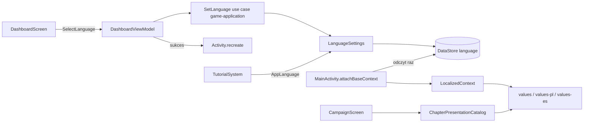

# LocalizationSystem — architektura i plan implementacji

## Status i cel

**LocalizationSystem nie jest zaimplementowany.** Ten dokument opisuje
zatwierdzoną architekturę przyszłego systemu języka i lokalizacji UI. Nic
poniżej nie opisuje działającego kodu, dopóki nie zostanie wdrożone zgodnie z
planem. Wymagania opisane jako „musi” są kryteriami akceptacji przyszłej
implementacji. Elementy oznaczone **(propozycja)** nie zostały zatwierdzone
wprost i wymagają akceptacji przed implementacją.

Cel: gracz wybiera język aplikacji (polski, angielski lub hiszpański) na Dashboardzie, a
cały tekst UI Androida oraz tytuły rozdziałów kampanii są wyświetlane w tym
języku. System dostarcza też port `LanguageSettings`, z którego korzysta
`TutorialSystem` (patrz `docs/systems/tutorial-system.md`).

Typ systemu: przekrojowy — aplikacyjny (ustawienie, use case, persystencja) i
prezentacyjny (zasoby, wrapper kontekstu, przełącznik na Dashboardzie).

Legacy (`~/workspace/orc-catapult`, tylko do odczytu): `LanguageManager` używa
`AppCompatDelegate.setApplicationLocales`, SharedPreferences i domyślnego `pl`.
Legacy zachowuje język przy resecie postępu. Kodu legacy nie kopiuję.

## Zatwierdzone decyzje

| Decyzja | Wybór |
|---|---|
| Zakres v1 | UI Androida plus teksty z danych kampanii (tytuły rozdziałów). Studio nie dostaje edytorów tłumaczeń. |
| Języki | Polski (`pl`), angielski (`en`) i hiszpański (`es`, wariant neutralny, jeden katalog `values-es`; bez `es-ES`/`es-419`). |
| Język domyślny | **Angielski**, gdy brak zapisanego wyboru. Język systemu nie jest brany pod uwagę. |
| Miejsce zmiany | Tylko Dashboard, jeden panel w stylu HUD z trzema segmentami `PL | EN | ES` (aktywny podświetlony); dotknięcie innego segmentu zmienia język od razu. Położenie na Dashboardzie jest dowolne i tymczasowe, bo Dashboard zostanie w całości przebudowany; przełącznik jest wtedy przenoszony razem z nim. |
| RESET | Dashboard RESET **nie** czyści języka. |
| Zastosowanie języka | Własny wrapper `Context` w `attachBaseContext` (`Configuration.setLocale`) plus `recreate()`. Działa od API 24 bez zmiany `Activity` i motywu. |
| Właściciel języka | Osobny DataStore, odczytany raz synchronicznie przy starcie. Własny wpis w systemowych ustawieniach języka aplikacji nie jest deklarowany, więc nie ma drugiego źródła prawdy. |
| Tytuły rozdziałów | Presentation-side: dane kampanii trzymają tylko stabilne `id`; tytuły są w `strings.xml` (`values/`, `values-pl/`, `values-es/`). Pole `title` znika z JSON i z kontraktu `game-campaign`. Studio pokazuje `id`. |
| Tłumaczenia PL | Przeniesione z legacy tam, gdzie znaczenie pasuje; resztę tłumaczy agent. Cała lista idzie do akceptacji użytkownika przed uznaniem lokalizacji za gotową. |
| Tłumaczenia ES | Legacy nie ma hiszpańskiego, więc całość tłumaczy agent. Lista (klucz, EN, ES; źródło zawsze `nowe`) idzie do akceptacji użytkownika razem z PL. |
| Teksty tutoriali | Pozostają w JSON tutoriali (`pl`/`en`/`es`); nie należą do `strings.xml`. Brak `es` w tutorialu to jawny błąd walidacji katalogu. |

## Zakres

W zakresie:

- kontrakt `AppLanguage` i port `LanguageSettings` w `game-application`;
- use case wyboru języka z jawnym wynikiem;
- adapter DataStore, odczyt przy starcie, wrapper `Context`, `recreate()`;
- przełącznik języka na Dashboardzie;
- lokalizacja `strings.xml` do `values/` (EN, baza), `values-pl/` (PL) i
  `values-es/` (ES);
- przegląd i przeniesienie widocznych dla gracza literałów z kodu Androida do
  zasobów;
- tytuły rozdziałów kampanii z zasobów po `id`;
- testy parytetu zasobów i granicy architektury.

## Poza zakresem

- trzeci język i wybór „język systemu”;
- zmiana języka poza Dashboardem (w trakcie meczu, w Loadoucie, w Kampanii);
- lokalizacja Urkaaaz Studio i jego edytorów;
- tłumaczenie tytułów poziomów (poziomy nie mają dziś tytułów w kodzie ani
  danych);
- teksty tutoriali — należą do `TutorialSystem`;
- nazwy techniczne: klucze assetów, identyfikatory, logi, komunikaty błędów
  developerskich;
- zdalna dystrybucja tłumaczeń i hot reload;
- import języka z legacy;
- lokalizacja assetów graficznych z tekstem.

## Istniejące rozwiązania i ryzyko duplikacji

| Istniejące | Stan | Decyzja |
|---|---|---|
| `android-app/src/main/res/values/strings.xml` | 294 stringi, ok. 324 użyć `R.string.*` w 15 plikach; jedyna baza tekstów. Bez `values-pl`. | Pozostaje angielską bazą i jedynym katalogiem tekstów UI. Dochodzą `values-pl/strings.xml` i `values-es/strings.xml`. Brak `values-en`, bo byłby kopią bazy. |
| `BossPresentationCatalog` (nazwy bossów przez `R.string`) | Wzorzec: stabilne ID → jawny `R.string`. | Ten sam wzorzec dla tytułów rozdziałów. |
| `campaign-chapters.json` (`title`) | Angielski tytuł, używany przez `CampaignChapterRegistry`, walidację unikalności w `CampaignChapterCatalogRepository`, `CampaignScreen`, Studio (`campaignMapCatalog.ts`, `MapsTab`, `CampaignTab`). | `title` jest usuwany. Gra bierze tytuł z zasobów po `id`; Studio pokazuje `id`. |
| `TutorialSystem` teksty `pl`/`en` w JSON | Osobny, zatwierdzony mechanizm treści; teksty `pl`/`en` dostają `es`. | Konsumuje tylko `AppLanguage` z portu. |
| `LocalPreferencesDataStore` / `DataStorePlayerProgressResetRepository` | Jeden Preferences DataStore; RESET czyści go w całości poza hashem presetu. | Język **nie może** tam trafić. Osobny plik DataStore. |
| Legacy `LanguageManager` | `AppCompatDelegate` + SharedPreferences, `pl` domyślnie. | Tylko odniesienie. `AppCompatDelegate` odrzucone, patrz „Warianty”. |
| `MainActivity` | `ComponentActivity`, motyw `Theme.Urkaaaz` (platformowy Material), `minSdk 24`, brak odtwarzania stanu nawigacji. | Wrapper kontekstu nie wymaga zmiany klasy ani motywu. Odtwarzanie Dashboardu opisane w „Lifecycle”. |

Nie istnieje inny system języka ani drugi katalog tekstów UI; rekomendacja nie
duplikuje funkcjonalności.

## Właściciel i kierunek zależności

| Odpowiedzialność | Właściciel |
|---|---|
| `AppLanguage`, port `LanguageSettings`, use case wyboru języka, typy wyników | `game-application`, pakiet `com.urkaaaz.application.language`. Bez Androida. |
| Adapter DataStore, odczyt startowy, wrapper `Context`, `recreate()` | `android-app`, pakiet `persistence` oraz `com.urkaaaz.localization`. |
| Przełącznik na Dashboardzie | `android-app`, `DashboardScreen` / `DashboardViewModel` / `DashboardUiAction`. |
| Teksty UI | `android-app/src/main/res/values/strings.xml`, `values-pl/strings.xml` i `values-es/strings.xml`. |
| Mapowanie `id` rozdziału → tytuł | `android-app`, katalog prezentacji rozdziałów (jak `BossPresentationCatalog`). |
| Dane rozdziałów (tylko `id`, zakres poziomów, biom, bossy) | `game-campaign`. |

Nowego modułu Gradle nie potrzeba. `game-contracts`, `game-domain`,
`game-simulation`, `game-ai` nie zależą od LocalizationSystem. `game-campaign`
tylko traci pole `title`.

Kierunek: `android-app` → `game-application`. Engine tutoriala i use case nie
znają `Context`, `Locale` Androida ani `R.string`.

## Kontrakty (opis, nie kod)

Wszystkie kontrakty są niemutowalne.

- **`AppLanguage`**: zamknięty zbiór `PL`, `EN`, `ES` z tagiem BCP-47 (`pl`, `en`, `es`).
  Stała `DEFAULT = EN` jest regułą kontraktu, nie fallbackiem adaptera.
- **`LanguageSettings`** (port): `load()` zwraca `LanguageLoadResult`;
  `save(language)` zwraca `LanguageSaveResult`.
- **`LanguageLoadResult`**: `Loaded(language, source)` gdzie `source` to
  `STORED` albo `DEFAULT_NO_STORED_VALUE`; `Failure(reason)` z powodami
  `STORAGE_UNAVAILABLE`, `UNSUPPORTED_VALUE`.
- **`LanguageSaveResult`**: `Saved(language)`, `Unchanged(language)`,
  `Failure(reason)`.
- **Use case `SetLanguage`**: wejście `AppLanguage`; wynik ten sam co
  `LanguageSaveResult`. Użycie tego samego języka daje `Unchanged` i nie
  wywołuje `recreate()`.

Wejścia systemu: wybór gracza (`DashboardUiAction.SelectLanguage`) i zapisana
wartość. Wyjścia: `AppLanguage` dla silnika tutoriala, zlokalizowany
`Context`, wynik use case.

## Runtime state, konfiguracja i persystencja

| Dane | Typ | Właściciel |
|---|---|---|
| Wybrany język | Ustawienie trwałe | Osobny DataStore (**propozycja** nazwy pliku: `language_settings`), klucz `language.code`, `language.schema_version`. |
| Zlokalizowany `Context` | Efemeryczny, na czas życia `Activity` | `LocalizedContext` w `android-app`. |
| Teksty UI | Zasoby | `values/`, `values-pl/` i `values-es/`. |
| Tytuły rozdziałów | Zasoby + mapowanie | Katalog prezentacji rozdziałów. |

Zasady:

- Brak zapisanej wartości oznacza `EN` (`DEFAULT_NO_STORED_VALUE`); nie jest to
  błąd. Nieobsługiwana wartość w zapisie jest jawnym błędem, nie cichym
  zamiennikiem.
- Język nie trafia do `CampaignProgress`, profilu, loadoutu ani głównego
  Preferences DataStore. Dashboard RESET (`DataStorePlayerProgressResetRepository`)
  go nie rusza, bo dotyczy innego DataStore. Test musi to potwierdzać.
- Brak zapisu aktywnych widoków lub kopii tekstów: UI zawsze buduje się z
  zasobów w bieżącym zlokalizowanym `Context`.
- Demo (`TEST`, poziom 0) używa tego samego języka; język nie jest częścią
  postępu.

## Lifecycle

| Zdarzenie | Zachowanie |
|---|---|
| Start procesu / `Activity` | `attachBaseContext` odczytuje język raz, synchronicznie, i opakowuje `Context` wybranym `Locale`. Odczyt jest jedynym dopuszczonym blokującym wywołaniem DataStore w aplikacji i jest opisany w kodzie. |
| Wybór języka | `SelectLanguage(language)` → `SetLanguage`. Przy `Saved`: `recreate()`. Przy `Unchanged`: nic. Przy `Failure`: jawny komunikat na Dashboardzie, bez `recreate()`. |
| `recreate()` | Po ponownym utworzeniu `Activity` aplikacja wraca na Dashboard **(propozycja)**: przed `recreate()` bieżący ekran (zawsze Dashboard, bo tylko tam można zmienić język) zapisywany jest w `onSaveInstanceState` i odtwarzany w `onCreate`. Inne ekrany nie są odtwarzane. |
| Zmiana konfiguracji (obrót) | Jak dziś; wrapper zostaje, bo działa w `attachBaseContext`. |
| Mecz w trakcie | Język nie zmienia się w meczu. Przełącznik jest tylko na Dashboardzie. |
| Aktywny tutorial | Overlay blokuje dotyk poza celem kroku, więc przełącznik jest nieosiągalny, dopóki tutorial jest aktywny. Gdyby cel kroku był samym przełącznikiem, tutorial startuje od pierwszego kroku po `recreate()` (aktywny krok nie jest persystowany). |
| Dashboard RESET | Język pozostaje. |
| Failure odczytu przy starcie | Aplikacja startuje w `EN` **bez nadpisywania zapisu**, a błąd jest logowany jawnie **(propozycja; do akceptacji jako wyjątek od zakazu cichych fallbacków, bo aplikacja musi wystartować)**. |

## Przepływ komend, snapshotów i eventów

1. Dashboard wysyła `DashboardUiAction.SelectLanguage` do
   `DashboardViewModel`; ekran nie zapisuje niczego bezpośrednio.
2. ViewModel wywołuje use case `SetLanguage`, który przez `LanguageSettings`
   zapisuje wybór.
3. Wynik wraca do ViewModelu jako stan UI (przełącznik pokazuje aktywny język)
   lub błąd. Przy `Saved` ekran prosi host o `recreate()`.
4. Przy następnym `attachBaseContext` język jest odczytany z DataStore.
5. `TutorialSystem` odczytuje język przez ten sam port przy budowaniu
   `TutorialContext`.

Brak eventów gameplayu; brak komend do domeny lub symulacji.

## Determinizm, czas i replay

Lokalizacja nie wpływa na symulację: nie zmienia seeda, komend, snapshotów ani
replayu. Teksty są wyłącznie prezentacją. Formatowanie liczb w logach i
plikach developerskich pozostaje `Locale.US`, aby logi były porównywalne.

**(propozycja)** Liczby widoczne dla gracza (np. czas przeładowania w
`AmmunitionPanelView`) są formatowane według `Locale` aplikacji, więc po
polsku i hiszpańsku z przecinkiem. Wymaga akceptacji, bo zmienia dziś stały `Locale.US`.

## Integracja z istniejącymi systemami

### Dashboard

Dodaje panel `PL | EN | ES` (trzy segmenty, komponent w stylu HUD, `HudPanelStyle`,
`UiTypography`) oraz akcję `SelectLanguage`. Pozostałe elementy Dashboardu bez
zmian. Dla tutoriala Dashboardu przełącznik może być celem w katalogu
tutoriali (`targetId` do uzgodnienia w fazie treści tutoriali).

### Campaign

`CampaignScreen` zamiast `chapter.title` bierze tytuł z katalogu prezentacji po
`chapter.id`. W `game-campaign` usuwane są: pole `title` w kontrakcie i
`CampaignChapterRegistry`, walidacja unikalności i niepustości tytułu w
`CampaignChapterCatalogRepository` (zastąpiona walidacją unikalności `id`, jeśli
jej brakuje), pole `title` w `campaign-chapters.json`. Podniesienie
`schemaVersion` pliku **(propozycja)**, zgodnie z istniejącą praktyką
wersjonowania katalogów.

Katalog prezentacji ma jawne mapowanie `id → R.string` (bez
`Resources.getIdentifier`), konwencja nazw kluczy `chapter_title_<id>` (np.
`chapter_title_green_frontier`). Test sprawdza, że każdy `id` z katalogu
rozdziałów ma wpis i oba języki.

### Studio

Kontrakty i walidacja Studio (`campaignMapCatalog.ts`, kontrakty rozdziałów) tracą
pole `title`. `MapsTab` i `CampaignTab` pokazują `id` (np. `green_frontier`).
Testy Studio aktualizowane. Studio nie edytuje tłumaczeń.

### Loadout, Match, Shop, Result

Używają zasobów w zlokalizowanym `Context` bez zmian logiki. Wymagają
przeglądu literałów i formatów (patrz „Android UI”). Teksty parametryzowane
używają pozycyjnych argumentów (`%1$d`); liczby mnogie **(propozycja)**
`<plurals>` z formami wymaganymi przez polski (one/few/many/other) oraz
hiszpański (one/many/other).

### TutorialSystem

Konsumuje port `LanguageSettings` w `TutorialContext.language`. Ponieważ język
zmienia się wyłącznie przez `recreate()`, engine nie musi obserwować zmian
języka w trakcie tutoriala. To zastępuje zapis w `tutorial-system.md`
„Zmiana języka w trakcie tutoriala odświeża tekst bieżącego kroku”; dokument
tutoriala jest aktualizowany razem z tym dokumentem.

## Obsługa błędów i odrzuceń

Błędy są jawne i typowane; brak szerokich `catch` i cichych fallbacków.

| Sytuacja | Zachowanie |
|---|---|
| Brak zapisanej wartości | `Loaded(EN, DEFAULT_NO_STORED_VALUE)`; to reguła kontraktu. |
| Nieobsługiwana wartość w zapisie | `Failure(UNSUPPORTED_VALUE)`; dane nie są kasowane ani nadpisywane. |
| Nowsza wersja schematu niż obsługiwana | `Failure(UNSUPPORTED_VALUE)`; dane nie są kasowane. |
| Błąd IO przy odczycie startowym | `Failure(STORAGE_UNAVAILABLE)`; start w `EN` z jawnym logiem (**propozycja**, patrz Lifecycle). |
| Błąd IO przy zapisie wyboru | `Failure(STORAGE_UNAVAILABLE)`; Dashboard pokazuje błąd, brak `recreate()`, brak ponowienia bez wiedzy gracza. |
| Wybór aktualnego języka | `Unchanged`, brak `recreate()`. |
| Brak klucza w `values-pl` lub `values-es` | Test parytetu kończy się błędem; lint `MissingTranslation` jest błędem **(propozycja)**. |
| `id` rozdziału bez wpisu w katalogu prezentacji | Błąd testu; w runtime jawny wyjątek z `id`, nie pusty tytuł. |

## Android UI i assety

### Komponenty

- `LocalizedContext` — wrapper `Context` budowany z `AppLanguage`.
- Odczyt startowy w `MainActivity.attachBaseContext`; `MainActivity` nie
  dostaje innej logiki języka (tylko wywołanie wrappera i `recreate()` na
  żądanie hosta).
- Przełącznik `PL | EN | ES` na Dashboardzie jako osobny widok, z
  `contentDescription` każdego segmentu i minimalnym rozmiarem celu dotyku
  `48 dp` na segment.
- Katalog prezentacji rozdziałów.
- Konfiguracja `Locale` jest ustawiana wyłącznie przez wrapper; kod UI nie
  wywołuje `Locale.setDefault`.

### Reguły

1. Każdy tekst widoczny dla gracza pochodzi z zasobów lub z JSON tutoriala.
   Tekst budowany jest z `Context` aktywności (zlokalizowanego). Użycie
   `applicationContext.getString` dla tekstu UI jest zabronione, bo nie ma
   wrappera.
2. Przegląd literałów tekstowych w kodzie Androida (ok. 240 kandydatów):
   większość to klucze assetów i nazwy techniczne i **zostaje**; literały
   widoczne dla gracza trafiają do zasobów **(propozycja przeglądu)**. Lista
   przeniesionych i pozostawionych literałów jest wypisana w podsumowaniu
   implementacji.
3. Czcionka `cinzel_variable.ttf` (używana przez `Theme.Urkaaaz`) zawiera
   polskie znaki `ąćęłńóśźżĄĆĘŁŃÓŚŹŻ` oraz hiszpańskie `áéíóúüñÁÉÍÓÚÜÑ¿¡`
   (oba zestawy sprawdzone przy projektowaniu przez parsowanie cmap). Zmiana
   czcionki wymaga ponownego sprawdzenia pokrycia.
4. Polskie i hiszpańskie teksty są zwykle dłuższe niż angielskie. Panele o stałym rozmiarze
   (kafle Loadoutu, HUD, przyciski) muszą zawijać lub obcinać tekst bez
   zmiany wymiarów; wymaga to przeglądu wizualnego wszystkich trzech języków.
5. Położenie przełącznika na Dashboardzie jest dowolne i tymczasowe (decyzja
   użytkownika: Dashboard zostanie w całości przebudowany). Wymaganie
   minimalne: przełącznik jest widoczny, dotykalny (`48 dp` na segment) i nie
   blokuje przycisków Dashboardu; bez osobnego przeglądu wizualnego położenia.

### Assety

Pierwsza wersja nie dodaje assetów graficznych; przełącznik jest rysowany
stylem HUD w kodzie. Ewentualne flagi lub ikony wymagają osobnej specyfikacji
AGP i akceptacji.

### Tłumaczenia

Polskie teksty: z `values-pl/strings.xml` legacy tam, gdzie znaczenie pasuje
do aktualnego klucza; resztę tłumaczy agent. Hiszpańskie teksty (neutralny
`es`) w całości tłumaczy agent, bo legacy nie ma hiszpańskiego. Cała lista
(klucz, EN, PL, ES, źródło PL: `legacy` lub `nowe`; źródło ES: `nowe`) idzie do
akceptacji użytkownika; bez niej lokalizacja nie jest uznana za gotową. Teksty
legacy są źródłem do ręcznego przeniesienia, nie są kopiowane automatycznie.

## Plan testów i kryteria akceptacji

### `game-application` (JVM, bez Androida)

- `AppLanguage`: tagi, zbiór zamknięty (`PL`, `EN`, `ES`), domyślny `EN`;
- `SetLanguage`: `Saved`, `Unchanged`, `Failure`; brak zapisu przy
  `Unchanged`;
- port z fake'iem: brak zapisu → `DEFAULT_NO_STORED_VALUE`; nieobsługiwana
  wartość → `Failure(UNSUPPORTED_VALUE)`;
- brak importów Android w `game-application`.

### `android-app`

- adapter DataStore: round-trip, brak klucza, nieobsługiwana wartość, nowszy
  schemat, błąd IO;
- język przetrwa Dashboard RESET (`DataStorePlayerProgressResetRepository`);
- `LocalizedContext`: `getString` zwraca tekst PL, EN albo ES dla odpowiedniego
  `AppLanguage`;
- parytet kluczy `values/strings.xml`, `values-pl/strings.xml` i
  `values-es/strings.xml`, w tym zgodne
  argumenty formatowania (`%1$d` itd.) i zgodne `<plurals>`;
- `DashboardViewModel`: `SelectLanguage` → wywołanie use case; `Unchanged` bez
  `recreate()`; `Failure` bez `recreate()`;
- katalog prezentacji rozdziałów: każdy `id` z `campaign-chapters.json` ma
  wpis i oba tłumaczenia;
- brak odwołań do `chapter.title` oraz do `applicationContext.getString` dla
  tekstu UI (test lub reguła przeglądu);
- odtworzenie Dashboardu po `recreate()` **(propozycja)**.

### `game-campaign` i Studio

- `campaign-chapters.json` bez pola `title`, kontrakt i walidacja aktualne;
  unikalność `id`;
- Studio: kontrakty, walidacja i testy bez `title`; `npm test && npm run lint`.

### Kryteria akceptacji

1. Pierwsze uruchomienie pokazuje angielski UI.
2. Dotknięcie `PL` albo `ES` na Dashboardzie przełącza cały UI na wybrany język
   i zostaje na Dashboardzie; ponowne uruchomienie zachowuje wybór.
3. Dashboard RESET nie zmienia języka.
4. Tytuły rozdziałów w Kampanii są w wybranym języku.
5. `values/`, `values-pl/` i `values-es/` mają ten sam zestaw kluczy; listy
   tłumaczeń PL i ES zostały zaakceptowane.
6. Żaden widoczny dla gracza literał nie pozostał w kodzie bez uzasadnienia.
7. Symulacja, replay i snapshoty są niezmienione.
8. `./gradlew test assembleDebug --quiet` oraz `npm test && npm run lint` w
   `studio/` przechodzą.

## Plan wdrożenia (fazy)

1. **Kontrakty i port** w `game-application`: `AppLanguage`, `LanguageSettings`,
   `SetLanguage`, testy JVM. To odblokowuje fazę 1 TutorialSystemu.
2. **Persystencja i start**: adapter DataStore języka, `LocalizedContext`,
   `attachBaseContext`, testy; RESET nie czyści języka.
3. **Przełącznik na Dashboardzie** i `recreate()` z odtworzeniem Dashboardu.
4. **Tytuły rozdziałów**: usunięcie `title` z `game-campaign` i Studio, katalog
   prezentacji, `strings.xml`.
5. **Lokalizacja UI**: przegląd literałów, `values-pl`, `values-es`, lista
   tłumaczeń do akceptacji, testy parytetu, lint.
6. **Dokumentacja**: aktualizacja `current-state.md`, `knowledge.md`,
   `architecture.md` (persystencja), glosariusza i `tutorial-system.md`.

Fazy 1–2 wystarczają, aby TutorialSystem miał działający `LanguageSettings`;
pełna lokalizacja UI (faza 5) dochodzi niezależnie.

## Proponowane pliki do przyszłej implementacji

- `game-application/src/main/kotlin/com/urkaaaz/application/language/` —
  `AppLanguage.kt`, `LanguageSettings.kt`, `LanguageResults.kt`,
  `SetLanguage.kt`;
- `game-application/src/test/kotlin/com/urkaaaz/application/language/`;
- `android-app/.../persistence/DataStoreLanguageSettings.kt` (osobny plik
  DataStore, obok `LocalPreferencesDataStore`);
- `android-app/.../localization/` — `LocalizedContext.kt`,
  `StartupLanguageReader.kt`;
- zmiany w `MainActivity` (tylko `attachBaseContext`, `recreate()`, odtworzenie
  Dashboardu), `DashboardScreen`, `DashboardViewModel`, `DashboardUiAction`,
  `DashboardUiState`;
- nowy widok przełącznika w `screens/dashboard/`;
- `android-app/.../screens/campaign/ChapterPresentationCatalog.kt`, zmiana w
  `CampaignScreen`;
- `android-app/src/main/res/values/strings.xml`,
  `android-app/src/main/res/values-pl/strings.xml`,
  `android-app/src/main/res/values-es/strings.xml`;
- `game-campaign/.../CampaignChapterRegistry.kt`,
  `CampaignChapterCatalogRepository.kt`, `campaign-chapters.json` i testy;
- `studio/server/src/services/campaignMapCatalog.ts`, kontrakty rozdziałów,
  `studio/web/src/tabs/maps/MapsTab.tsx`, `studio/web/src/tabs/campaign/CampaignTab.tsx`
  i testy;
- `docs/systems/tutorial-system.md` (zapis o zmianie języka w trakcie
  tutoriala i status dokumentu lokalizacji).

## Rozważone warianty

| Wariant | Czytelność | Testowalność | Koszt | Uwagi |
|---|---|---|---|---|
| **Własny wrapper `Context` + `recreate()`, język w osobnym DataStore (rekomendowany)** | Wysoka | Wysoka | Niski | Działa od API 24 bez zmiany `Activity` i motywu; jedno źródło prawdy. Wymaga jednego blokującego odczytu przy starcie. |
| `AppCompatDelegate.setApplicationLocales` | Wysoka | Średnia | Wysoki | Na API 24–32 działa tylko dla `AppCompatActivity`, więc wymaga zmiany klasy i motywu na AppCompat, a na API 33+ zapisuje drugą kopię języka w systemie. Odrzucony. |
| Język w SharedPreferences zamiast DataStore | Wysoka | Wysoka | Niski | Odczyt synchroniczny bez `runBlocking`, ale wprowadza inny mechanizm persystencji niż reszta aplikacji. Alternatywa, jeśli odczyt startowy okaże się problemem. |
| Przebudowa widoków bez `recreate()` | Niska | Niska | Wysoki | Wymaga, aby każdy ekran umiał odbudować wszystkie teksty; duże ryzyko pominięć. Odrzucony. |
| Tytuły w JSON jako `{pl, en}` | Średnia | Średnia | Średni | Druga lokalizacja tłumaczeń obok `strings.xml`, edycja w Studio. Odrzucone na rzecz jednego katalogu tekstów. |

## Otwarte decyzje i niedokończony zakres

Rozstrzygnięte: patrz „Zatwierdzone decyzje”.

Propozycje do akceptacji przed implementacją:

1. Nazwa pliku DataStore (`language_settings`) i klucze `language.*`.
2. Odtworzenie Dashboardu po `recreate()` przez `onSaveInstanceState`.
3. Zachowanie przy błędzie odczytu startowego: start w `EN` z logiem, bez
   nadpisywania zapisu.
4. Podniesienie `schemaVersion` w `campaign-chapters.json` po usunięciu
   `title`.
5. Formatowanie liczb widocznych dla gracza według `Locale` aplikacji zamiast
   `Locale.US`.
6. `<plurals>` dla tekstów z liczbami; lint `MissingTranslation` jako błąd;
   test parytetu kluczy i argumentów.
7. Przegląd i przeniesienie widocznych literałów z kodu Androida do zasobów.

Niedokończone: listy tłumaczeń PL i ES wymagają akceptacji użytkownika; tytuły
poziomów nie istnieją i nie są lokalizowane.
