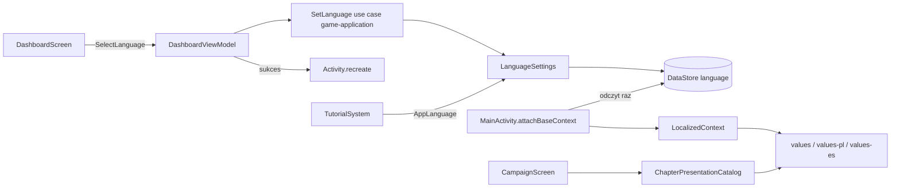

# LocalizationSystem — architektura i plan implementacji

## Status i cel

**Status: zaimplementowany i zatwierdzony.** Kontrakt aplikacyjny,
persystencja języka, lokalizowany `Context`, selektor Dashboardu, prezentacyjne
tytuły rozdziałów oraz zasoby PL/ES są zaimplementowane. Użytkownik zaakceptował
pełną listę tłumaczeń PL/ES. Ręczny przegląd wizualny Dashboardu, kampanii,
Loadoutu i HUD-u w EN/PL/ES został wykonany na emulatorze Pixel 8; w razie
zmian tekstów należy go powtórzyć.

Plan przyszłego, ograniczonego rozszerzenia typografii przycisków per język i
jej edycji w Studio znajduje się w
[`localized-button-typography-plan.md`](localized-button-typography-plan.md),
a instrukcje implementacji w
[`localized-button-typography-implementation-prompt.md`](localized-button-typography-implementation-prompt.md).
Nie zmienia on zakresu LocalizationSystem ani nie dodaje edycji tłumaczeń w
Studio.

Automatyczny `./gradlew test assembleDebug --quiet`, testy i lint Studio oraz
`git diff --check` przechodzą. `:android-app:lintDebug` nie kończy się
powodzeniem z powodu dwóch istniejących błędów `AppCompatCustomView`
(`CampaignBossMarkerImageView` i `MatchFeedbackToastView`); raport nie zawiera
błędów `MissingTranslation`.

Cel: gracz wybiera język aplikacji (polski, angielski lub hiszpański) na Dashboardzie, a
cały tekst UI Androida oraz tytuły rozdziałów kampanii są wyświetlane w tym
języku. System dostarcza też port `LanguageSettings`, z którego korzysta
`TutorialSystem` (patrz `docs/systems/tutorial-system.md`).

Typ systemu: przekrojowy — aplikacyjny (ustawienie, use case, persystencja) i
prezentacyjny (zasoby, wrapper kontekstu, przełącznik na Dashboardzie).

Legacy (`~/workspace/orc-catapult`, tylko do odczytu): `LanguageManager` używa
`AppCompatDelegate.setApplicationLocales`, SharedPreferences i domyślnego `pl`.
Legacy zachowuje język przy resecie postępu. Kodu legacy nie kopiuję.

## Zatwierdzone decyzje

| Decyzja | Wybór |
|---|---|
| Zakres v1 | UI Androida plus teksty z danych kampanii (tytuły rozdziałów). Studio nie dostaje edytorów tłumaczeń. |
| Języki | Polski (`pl`), angielski (`en`) i hiszpański (`es`, wariant neutralny, jeden katalog `values-es`; bez `es-ES`/`es-419`). |
| Język domyślny | **Angielski**, gdy brak zapisanego wyboru. Język systemu nie jest brany pod uwagę. |
| Miejsce zmiany | Tylko Dashboard: przycisk z flagą aktualnie wybranego języka w nagłówku otwiera kompaktowy panel HUD z flagami Polski (`pl`), Wielkiej Brytanii (`en`) i Hiszpanii (`es`). Aktywna flaga jest podświetlona; dotknięcie innej natychmiast wybiera język. Każda opcja ma `contentDescription` i cel dotyku co najmniej 48 dp. |
| RESET | Dashboard RESET **nie** czyści języka. |
| Zastosowanie języka | Własny wrapper `Context` w `attachBaseContext` (`Configuration.setLocale`) plus `recreate()`. Działa od API 24 bez zmiany `Activity` i motywu. |
| Właściciel języka | Osobny DataStore, odczytany raz synchronicznie przy starcie. Własny wpis w systemowych ustawieniach języka aplikacji nie jest deklarowany, więc nie ma drugiego źródła prawdy. |
| Tytuły rozdziałów | Presentation-side: dane kampanii trzymają tylko stabilne `id`; tytuły są w `strings.xml` (`values/`, `values-pl/`, `values-es/`). Pole `title` znika z JSON i z kontraktu `game-campaign`. Studio pokazuje `id`. |
| Tłumaczenia PL | Przeniesione z legacy tam, gdzie znaczenie pasuje; resztę przygotował agent. Pełna lista z rozróżnieniem źródła `legacy`/`nowe` została zaakceptowana przez użytkownika. |
| Tłumaczenia ES | Legacy nie ma hiszpańskiego, więc całość przygotował agent. Pełna lista (klucz, EN, ES; źródło `nowe`) została zaakceptowana przez użytkownika razem z PL. |
| Teksty tutoriali | Pozostają w JSON tutoriali (`pl`/`en`/`es`); nie należą do `strings.xml`. Brak `es` w tutorialu to jawny błąd walidacji katalogu. |

## Zakres

W zakresie:

- kontrakt `AppLanguage` i port `LanguageSettings` w `game-application`;
- use case wyboru języka z jawnym wynikiem;
- adapter DataStore, odczyt przy starcie, wrapper `Context`, `recreate()`;
- przełącznik języka na Dashboardzie;
- lokalizacja `strings.xml` do `values/` (EN, baza), `values-pl/` (PL) i
  `values-es/` (ES);
- przegląd i przeniesienie widocznych dla gracza literałów z kodu Androida do
  zasobów;
- tytuły rozdziałów kampanii z zasobów po `id`;
- testy parytetu zasobów i granicy architektury.

## Poza zakresem

- trzeci język i wybór „język systemu”;
- zmiana języka poza Dashboardem (w trakcie meczu, w Loadoucie, w Kampanii);
- lokalizacja Urkaaaz Studio i jego edytorów;
- tłumaczenie tytułów poziomów (poziomy nie mają dziś tytułów w kodzie ani
  danych);
- teksty tutoriali — należą do `TutorialSystem`;
- nazwy techniczne: klucze assetów, identyfikatory, logi, komunikaty błędów
  developerskich;
- zdalna dystrybucja tłumaczeń i hot reload;
- import języka z legacy;
- lokalizacja assetów graficznych z tekstem.

## Istniejące rozwiązania i ryzyko duplikacji

| Istniejące | Stan | Decyzja |
|---|---|---|
| `android-app/src/main/res/values/strings.xml` | Angielska baza; 388 wpisów `string`/`plurals` wraz z pełnymi katalogami `values-pl` i `values-es`. | Baza pozostaje po angielsku; oba katalogi lokalizacji mają parytet kluczy i argumentów. Nie ma `values-en`, bo byłby kopią bazy. Tłumaczenia czekają na akceptację. |
| `BossPresentationCatalog` (nazwy bossów przez `R.string`) | Wzorzec: stabilne ID → jawny `R.string`. | Ten sam wzorzec dla tytułów rozdziałów. |
| `campaign-chapters.json` | Katalog schema 2 przechowuje stabilne ID, zakres poziomów, biom i boss positions; bez `title`. | Gra mapuje ID na `R.string.chapter_title_<id>`; Studio pokazuje ID. |
| `TutorialSystem` teksty `pl`/`en` w JSON | Osobny mechanizm treści; katalog tutoriala waliduje wszystkie trzy języki. | TutorialSystem konsumuje `AppLanguage` przez `LanguageSettings`; nie przejmuje ustawienia ani nie obserwuje zmian podczas kroku. |
| `LocalPreferencesDataStore` / `DataStorePlayerProgressResetRepository` | Główny Preferences DataStore jest czyszczony podczas RESET poza hashem presetu. | Język zapisuje osobny `language_settings`; reset progresu go nie dotyka. |
| Legacy `LanguageManager` | `AppCompatDelegate` + SharedPreferences, `pl` domyślnie. | Tylko odniesienie. `AppCompatDelegate` odrzucone, patrz „Warianty”. |
| `MainActivity` | `ComponentActivity`, motyw `Theme.Urkaaaz` (platformowy Material), `minSdk 24`; przy odtworzeniu zachowuje Dashboard, ale nie inne ekrany. | `attachBaseContext` opakowuje kontekst; nie używa `AppCompatDelegate`, nie zmienia klasy ani motywu. |

Nie istnieje inny system języka ani drugi katalog tekstów UI; rekomendacja nie
duplikuje funkcjonalności.

## Właściciel i kierunek zależności

| Odpowiedzialność | Właściciel |
|---|---|
| `AppLanguage`, port `LanguageSettings`, use case wyboru języka, typy wyników | `game-application`, pakiet `com.urkaaaz.application.language`. Bez Androida. |
| Adapter DataStore, odczyt startowy, wrapper `Context`, `recreate()` | `android-app`, pakiet `persistence` oraz `com.urkaaaz.localization`. |
| Przełącznik na Dashboardzie | `android-app`, `DashboardScreen` / `DashboardViewModel` / `DashboardUiAction`. |
| Teksty UI | `android-app/src/main/res/values/strings.xml`, `values-pl/strings.xml` i `values-es/strings.xml`. |
| Mapowanie `id` rozdziału → tytuł | `android-app`, katalog prezentacji rozdziałów (jak `BossPresentationCatalog`). |
| Dane rozdziałów (tylko `id`, zakres poziomów, biom, bossy) | `game-campaign`. |

Nowego modułu Gradle nie potrzeba. `game-contracts`, `game-domain`,
`game-simulation`, `game-ai` nie zależą od LocalizationSystem. `game-campaign`
tylko traci pole `title`.

Kierunek: `android-app` → `game-application`. Engine tutoriala i use case nie
znają `Context`, `Locale` Androida ani `R.string`.

## Kontrakty (opis, nie kod)

Wszystkie kontrakty są niemutowalne.

- **`AppLanguage`**: zamknięty zbiór `PL`, `EN`, `ES` z tagiem BCP-47 (`pl`, `en`, `es`).
  Stała `DEFAULT = EN` jest regułą kontraktu, nie fallbackiem adaptera.
- **`LanguageSettings`** (port): `load()` zwraca `LanguageLoadResult`;
  `save(language)` zwraca `LanguageSaveResult`.
- **`LanguageLoadResult`**: `Loaded(language, source)` gdzie `source` to
  `STORED` albo `DEFAULT_NO_STORED_VALUE`; `Failure(reason)` z powodami
  `STORAGE_UNAVAILABLE`, `UNSUPPORTED_VALUE`.
- **`LanguageSaveResult`**: `Saved(language)`, `Unchanged(language)`,
  `Failure(reason)`.
- **Use case `SetLanguage`**: wejście `AppLanguage`; wynik ten sam co
  `LanguageSaveResult`. Użycie tego samego języka daje `Unchanged` i nie
  wywołuje `recreate()`.

Wejścia systemu: wybór gracza (`DashboardUiAction.SelectLanguage`) i zapisana
wartość. Wyjścia: `AppLanguage` dla silnika tutoriala, zlokalizowany
`Context`, wynik use case.

## Runtime state, konfiguracja i persystencja

| Dane | Typ | Właściciel |
|---|---|---|
| Wybrany język | Ustawienie trwałe | Osobny DataStore `language_settings`, klucze `language.code` i `language.schema_version`. |
| Zlokalizowany `Context` | Efemeryczny, na czas życia `Activity` | `LocalizedContext` w `android-app`. |
| Teksty UI | Zasoby | `values/`, `values-pl/` i `values-es/`. |
| Tytuły rozdziałów | Zasoby + mapowanie | Katalog prezentacji rozdziałów. |

Zasady:

- Brak zapisanej wartości oznacza `EN` (`DEFAULT_NO_STORED_VALUE`); nie jest to
  błąd. Nieobsługiwana wartość w zapisie jest jawnym błędem, nie cichym
  zamiennikiem.
- Język nie trafia do `CampaignProgress`, profilu, loadoutu ani głównego
  Preferences DataStore. Dashboard RESET (`DataStorePlayerProgressResetRepository`)
  go nie rusza, bo dotyczy innego DataStore. Test musi to potwierdzać.
- Brak zapisu aktywnych widoków lub kopii tekstów: UI zawsze buduje się z
  zasobów w bieżącym zlokalizowanym `Context`.
- Demo (`TEST`, poziom 0) używa tego samego języka; język nie jest częścią
  postępu.

## Lifecycle

| Zdarzenie | Zachowanie |
|---|---|
| Start procesu / `Activity` | `attachBaseContext` odczytuje język raz, synchronicznie, i opakowuje `Context` wybranym `Locale`. Odczyt jest jedynym dopuszczonym blokującym wywołaniem DataStore w aplikacji i jest opisany w kodzie. |
| Wybór języka | `SelectLanguage(language)` → `SetLanguage`. Przy `Saved`: `recreate()`. Przy `Unchanged`: nic. Przy `Failure`: jawny komunikat na Dashboardzie, bez `recreate()`. |
| `recreate()` | `MainActivity` zapisuje w `onSaveInstanceState`, czy aktywny ekran to Dashboard. `onCreate` odtwarza tylko Dashboard; pozostałe ekrany wracają do Splash. |
| Zmiana konfiguracji (obrót) | Jak dziś; wrapper zostaje, bo działa w `attachBaseContext`. |
| Mecz w trakcie | Język nie zmienia się w meczu. Przełącznik jest tylko na Dashboardzie. |
| Aktywny tutorial | Overlay blokuje dotyk poza celem kroku, więc przełącznik jest nieosiągalny, dopóki tutorial jest aktywny. Gdyby cel kroku był samym przełącznikiem, tutorial startuje od pierwszego kroku po `recreate()` (aktywny krok nie jest persystowany). |
| Dashboard RESET | Język pozostaje. |
| Failure odczytu przy starcie | `StartupLanguageReader` loguje błąd i uruchamia aplikację w `EN` bez nadpisywania zapisu. |

## Przepływ komend, snapshotów i eventów

1. Dashboard wysyła `DashboardUiAction.SelectLanguage` do
   `DashboardViewModel`; ekran nie zapisuje niczego bezpośrednio.
2. ViewModel wywołuje use case `SetLanguage`, który przez `LanguageSettings`
   zapisuje wybór.
3. Wynik wraca do ViewModelu jako stan UI (przełącznik pokazuje aktywny język)
   lub błąd. Przy `Saved` ekran prosi host o `recreate()`.
4. Przy następnym `attachBaseContext` język jest odczytany z DataStore.
5. `TutorialSystem` odczytuje język przez ten sam port przy budowaniu
   `TutorialContext`.

Brak eventów gameplayu; brak komend do domeny lub symulacji.

## Determinizm, czas i replay

Lokalizacja nie wpływa na symulację: nie zmienia seeda, komend, snapshotów ani
replayu. Teksty są wyłącznie prezentacją. Formatowanie liczb w logach i
plikach developerskich pozostaje `Locale.US`, aby logi były porównywalne.

Liczby widoczne dla gracza są formatowane z zasobów zlokalizowanego `Context`
(w tym czas przeładowania w `AmmunitionPanelView`, zdrowie, mana i mnożnik
synergii). Logi i współrzędne developerskie pozostają przy `Locale.US`.

## Integracja z istniejącymi systemami

### Dashboard

Dodaje przycisk z flagą aktualnie wybranego języka w nagłówku, który otwiera
kompaktowy panel w stylu HUD (`HudPanelStyle`, `UiTypography`) z trzema
flagowymi przyciskami: Polska =
`PL`, Wielka Brytania = `EN`, Hiszpania = `ES`. Panel pokazuje aktywny język
przez podświetlenie flagi; dotknięcie innej flagi wysyła `SelectLanguage` i
natychmiast stosuje zmianę zgodnie z kontraktem poniżej. Widoczne są flagi bez
tekstowych skrótów; nazwy języków pozostają w opisach dostępności. Pozostałe
elementy Dashboardu nie są częścią LocalizationSystem. Dla tutoriala
Dashboardu przełącznik może być celem w katalogu tutoriali (`targetId` do
uzgodnienia w fazie treści tutoriali).

### Campaign

`CampaignScreen` zamiast `chapter.title` bierze tytuł z katalogu prezentacji po
`chapter.id`. W `game-campaign` usuwane są: pole `title` w kontrakcie i
`CampaignChapterRegistry`, walidacja unikalności i niepustości tytułu w
`CampaignChapterCatalogRepository` (zastąpiona walidacją unikalności `id`, jeśli
jej brakuje), pole `title` w `campaign-chapters.json`. Podniesienie
`schemaVersion` pliku do `2`, zgodnie z istniejącą praktyką
wersjonowania katalogów.

Katalog prezentacji ma jawne mapowanie `id → R.string` (bez
`Resources.getIdentifier`), konwencja nazw kluczy `chapter_title_<id>` (np.
`chapter_title_green_frontier`). Test sprawdza, że każdy `id` z katalogu
rozdziałów ma wpis i oba języki.

### Studio

Kontrakty i walidacja Studio (`campaignMapCatalog.ts`, kontrakty rozdziałów) tracą
pole `title`. `MapsTab` i `CampaignTab` pokazują `id` (np. `green_frontier`).
Testy Studio aktualizowane. Studio nie edytuje tłumaczeń.

### Loadout, Match, Shop, Result

Używają zasobów w zlokalizowanym `Context` bez zmian logiki. Wymagają
przeglądu literałów i formatów (patrz „Android UI”). Teksty parametryzowane
używają pozycyjnych argumentów (`%1$d`); liczby mnogie
`<plurals>` z formami wymaganymi przez polski (one/few/many/other) oraz
hiszpański (one/many/other).

### TutorialSystem

Konsumuje port `LanguageSettings` w `TutorialContext.language`. Ponieważ język
zmienia się wyłącznie przez `recreate()`, engine nie musi obserwować zmian
języka w trakcie tutoriala. To zastępuje zapis w `tutorial-system.md`
„Zmiana języka w trakcie tutoriala odświeża tekst bieżącego kroku”; dokument
tutoriala jest aktualizowany razem z tym dokumentem.

## Obsługa błędów i odrzuceń

Błędy są jawne i typowane; brak szerokich `catch` i cichych fallbacków.

| Sytuacja | Zachowanie |
|---|---|
| Brak zapisanej wartości | `Loaded(EN, DEFAULT_NO_STORED_VALUE)`; to reguła kontraktu. |
| Nieobsługiwana wartość w zapisie | `Failure(UNSUPPORTED_VALUE)`; dane nie są kasowane ani nadpisywane. |
| Nowsza wersja schematu niż obsługiwana | `Failure(UNSUPPORTED_VALUE)`; dane nie są kasowane. |
| Błąd IO przy odczycie startowym | `Failure(STORAGE_UNAVAILABLE)`; start w `EN` z jawnym logiem, bez nadpisywania zapisu. |
| Błąd IO przy zapisie wyboru | `Failure(STORAGE_UNAVAILABLE)`; Dashboard pokazuje błąd, brak `recreate()`, brak ponowienia bez wiedzy gracza. |
| Wybór aktualnego języka | `Unchanged`, brak `recreate()`. |
| Brak klucza w `values-pl` lub `values-es` | Test parytetu kończy się błędem; lint `MissingTranslation` jest błędem. |
| `id` rozdziału bez wpisu w katalogu prezentacji | Błąd testu; w runtime jawny wyjątek z `id`, nie pusty tytuł. |

## Android UI i assety

### Komponenty

- `LocalizedContext` — wrapper `Context` budowany z `AppLanguage`.
- Odczyt startowy w `MainActivity.attachBaseContext`; `MainActivity` nie
  dostaje innej logiki języka (tylko wywołanie wrappera i `recreate()` na
  żądanie hosta).
- Przycisk z flagą aktualnego języka w nagłówku Dashboardu otwiera osobny,
  kompaktowy widok z flagami Polski, Wielkiej Brytanii i Hiszpanii. Każda
  flaga ma opis dostępności, stan aktywny jest widoczny, a cel dotyku ma co
  najmniej 48 dp.
- Katalog prezentacji rozdziałów.
- Konfiguracja `Locale` jest ustawiana wyłącznie przez wrapper; kod UI nie
  wywołuje `Locale.setDefault`.

### Reguły

1. Każdy tekst widoczny dla gracza pochodzi z zasobów lub z JSON tutoriala.
   Tekst budowany jest z `Context` aktywności (zlokalizowanego). Użycie
   `applicationContext.getString` dla tekstu UI jest zabronione, bo nie ma
   wrappera.
2. Przegląd literałów tekstowych w kodzie Androida (ok. 240 kandydatów):
   większość to klucze assetów i nazwy techniczne i **zostaje**; literały
   widoczne dla gracza trafiają do zasobów. Lista
   przeniesionych i pozostawionych literałów jest wypisana w podsumowaniu
   implementacji.
3. Czcionka `cinzel_variable.ttf` (używana przez `Theme.Urkaaaz`) zawiera
   polskie znaki `ąćęłńóśźżĄĆĘŁŃÓŚŹŻ` oraz hiszpańskie `áéíóúüñÁÉÍÓÚÜÑ¿¡`
   (oba zestawy sprawdzone przy projektowaniu przez parsowanie cmap). Zmiana
   czcionki wymaga ponownego sprawdzenia pokrycia.
4. Polskie i hiszpańskie teksty są zwykle dłuższe niż angielskie. Panele o stałym rozmiarze
   (kafle Loadoutu, HUD, przyciski) muszą zawijać lub obcinać tekst bez
   zmiany wymiarów; wymaga to przeglądu wizualnego wszystkich trzech języków.
5. Przycisk z flagą aktualnego języka jest widoczny w nagłówku Dashboardu;
   otwiera panel flag
   położony przy nim, który nie zasłania głównych przycisków. Każda flaga ma
   cel dotyku co najmniej 48 dp; panel zamyka się po wyborze, dotknięciu poza
   nim lub systemowym Back.

### Assety

Dashboard używa istniejących drawable flag Polski, Wielkiej Brytanii i
Hiszpanii zarówno na przycisku języka, jak i w selektorze. Nie dodano nowych
assetów graficznych ani tekstowych
skrótów w obrazach.

### Tłumaczenia

Polskie teksty: z `values-pl/strings.xml` legacy tam, gdzie znaczenie pasuje
do aktualnego klucza; resztę przygotował agent. Hiszpańskie teksty (neutralny
`es`) przygotował agent, bo legacy nie ma hiszpańskiego. Pełna tabela (klucz,
EN, PL, ES, źródło PL: `legacy`/`nowe`, źródło ES: `nowe`) została
zaakceptowana przez użytkownika. Teksty legacy są źródłem do ręcznego
przeniesienia, nie są kopiowane automatycznie.

## Plan testów i kryteria akceptacji

### `game-application` (JVM, bez Androida)

- `AppLanguage`: tagi, zbiór zamknięty (`PL`, `EN`, `ES`), domyślny `EN`;
- `SetLanguage`: `Saved`, `Unchanged`, `Failure`; brak zapisu przy
  `Unchanged`;
- port z fake'iem: brak zapisu → `DEFAULT_NO_STORED_VALUE`; nieobsługiwana
  wartość → `Failure(UNSUPPORTED_VALUE)`;
- brak importów Android w `game-application`.

### `android-app`

- adapter DataStore: round-trip, brak klucza, nieobsługiwana wartość, nowszy
  schemat, błąd IO;
- język przetrwa Dashboard RESET (`DataStorePlayerProgressResetRepository`);
- `LocalizedContext`: `getString` zwraca tekst PL, EN albo ES dla odpowiedniego
  `AppLanguage`;
- parytet kluczy `values/strings.xml`, `values-pl/strings.xml` i
  `values-es/strings.xml`, w tym zgodne
  argumenty formatowania (`%1$d` itd.) i zgodne `<plurals>`;
- `DashboardViewModel`: `SelectLanguage` → wywołanie use case; `Unchanged` bez
  `recreate()`; `Failure` bez `recreate()`;
- selektor Dashboardu: poprawne mapowanie flag PL/UK/ES na `AppLanguage`,
  opis dostępności każdej opcji, podświetlenie aktywnej flagi i minimalny cel
  dotyku 48 dp; zamknięcie panelu po wyborze, poza nim i przez systemowy Back;
- katalog prezentacji rozdziałów: każdy `id` z `campaign-chapters.json` ma
  wpis i oba tłumaczenia;
- brak odwołań do `chapter.title` oraz do `applicationContext.getString` dla
  tekstu UI (test lub reguła przeglądu);
- odtworzenie Dashboardu po `recreate()` przez `DashboardRestoreState`.

### `game-campaign` i Studio

- `campaign-chapters.json` bez pola `title`, kontrakt i walidacja aktualne;
  unikalność `id`;
- Studio: kontrakty, walidacja i testy bez `title`; `npm test && npm run lint`.

### Kryteria akceptacji

1. Pierwsze uruchomienie pokazuje angielski UI.
2. Dotknięcie flagi Polski, Wielkiej Brytanii albo Hiszpanii w selektorze
   Dashboardu przełącza cały UI odpowiednio na PL, EN albo ES i zostaje na
   Dashboardzie; ponowne uruchomienie zachowuje wybór.
3. Dashboard RESET nie zmienia języka.
4. Tytuły rozdziałów w Kampanii są w wybranym języku.
5. `values/`, `values-pl/` i `values-es/` mają ten sam zestaw kluczy; listy
   tłumaczeń PL i ES zostały zaakceptowane.
6. Żaden widoczny dla gracza literał nie pozostał w kodzie bez uzasadnienia.
7. Symulacja, replay i snapshoty są niezmienione.
8. `./gradlew test assembleDebug --quiet` oraz `npm test && npm run lint` w
   `studio/` przechodzą.

## Status wdrożenia

1. **Kontrakty i port** — zaimplementowane w `game-application`, z testami JVM.
2. **Persystencja i start** — osobny DataStore, synchroniczny odczyt startowy,
   `LocalizedContext` i testy; RESET profilu nie usuwa języka.
3. **Selektor Dashboardu** — zaimplementowany; `SetLanguage` jest wywoływany
   przez `DashboardViewModel`, a wybór zapisany powoduje `recreate()`.
4. **Tytuły rozdziałów** — usunięte z kontraktu i katalogu schema 2; gra
   korzysta z jawnego katalogu prezentacji, a Studio pokazuje ID.
5. **Lokalizacja UI** — katalogi EN/PL/ES, plural forms, test parytetu i lint
   są dodane; wizualny przegląd wykonano, a tabela tłumaczeń została
   zaakceptowana.
6. **Dokumentacja** — aktualizowana razem z implementacją.

Etapy 1–2 udostępniają port `LanguageSettings` dla TutorialSystemu. Sam
TutorialSystem pozostaje poza zakresem tej implementacji.

## Główne pliki implementacji

- `game-application/.../language/AppLanguage.kt`,
  `LanguageSettings.kt`, `SetLanguage.kt`;
- `android-app/.../persistence/LanguageSettingsDataStore.kt`;
- `android-app/.../localization/LocalizedContext.kt` i
  `StartupLanguageReader.kt`;
- `android-app/.../screens/dashboard/DashboardLanguageFlag.kt`,
  `DashboardScreen.kt`, `DashboardViewModel.kt` oraz
  `navigation/DashboardRestoreState.kt`;
- `android-app/.../screens/campaign/CampaignChapterTitleResources.kt` i
  `CampaignScreen.kt`;
- zasoby `values/strings.xml`, `values-pl/strings.xml` i
  `values-es/strings.xml` oraz testy lokalizacji;
- `game-campaign` chapter definition/catalog/registry i `campaign-chapters.json`;
- Studio server contracts/catalog i zakładki Campaign/Maps.

## Rozważone warianty

| Wariant | Czytelność | Testowalność | Koszt | Uwagi |
|---|---|---|---|---|
| **Własny wrapper `Context` + `recreate()`, język w osobnym DataStore (rekomendowany)** | Wysoka | Wysoka | Niski | Działa od API 24 bez zmiany `Activity` i motywu; jedno źródło prawdy. Wymaga jednego blokującego odczytu przy starcie. |
| `AppCompatDelegate.setApplicationLocales` | Wysoka | Średnia | Wysoki | Na API 24–32 działa tylko dla `AppCompatActivity`, więc wymaga zmiany klasy i motywu na AppCompat, a na API 33+ zapisuje drugą kopię języka w systemie. Odrzucony. |
| Język w SharedPreferences zamiast DataStore | Wysoka | Wysoka | Niski | Odczyt synchroniczny bez `runBlocking`, ale wprowadza inny mechanizm persystencji niż reszta aplikacji. Alternatywa, jeśli odczyt startowy okaże się problemem. |
| Przebudowa widoków bez `recreate()` | Niska | Niska | Wysoki | Wymaga, aby każdy ekran umiał odbudować wszystkie teksty; duże ryzyko pominięć. Odrzucony. |
| Tytuły w JSON jako `{pl, en}` | Średnia | Średnia | Średni | Druga lokalizacja tłumaczeń obok `strings.xml`, edycja w Studio. Odrzucone na rzecz jednego katalogu tekstów. |

## Pozostałe granice zakresu

Nie ma otwartych decyzji ani zaległych kroków odbioru LocalizationSystem.
Tytuły poziomów nie istnieją i nie są lokalizowane; teksty tutoriala pozostają
właścicielstwem TutorialSystemu. Android lint nadal raportuje dwa istniejące,
niezwiązane błędy `AppCompatCustomView`; raport nie zawiera błędów
`MissingTranslation`.
