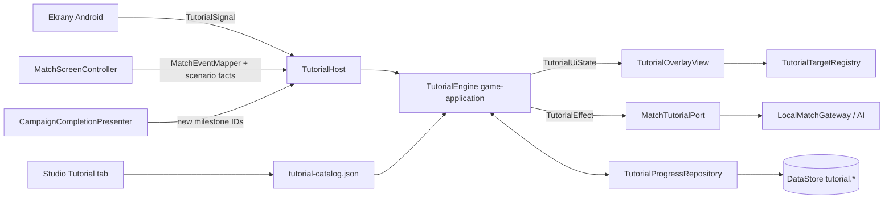

# TutorialSystem — architektura i plan implementacji

## Status i cel

**TutorialSystem v1 jest zaimplementowany.** Ten dokument zachowuje
architekturę i decyzje, a poniższa sekcja „Stan implementacji” rozróżnia
działające elementy od zawartości odłożonej do osobnej akceptacji. Runtime
katalog zawiera wyłącznie `match.basics`; pozostałych tematów nie dopisano,
ponieważ ich teksty i podział na kroki nie zostały jeszcze zaakceptowane.

Cel: prowadzić nowego gracza przez Dashboard, Kampanię, Loadout, Sklep i Mecz
kontekstowymi, jednorazowymi i pomijalnymi instrukcjami. Instrukcje wskazują
dokładne elementy UI lub pola bitwy, a w meczu mogą wstrzymać symulację i AI,
czekać na akcję gracza oraz blokować panele do czasu ich wprowadzenia.

Typ systemu: przekrojowy — aplikacyjny (reguły, stan, persystencja),
prezentacyjny (overlay Android) i authoringowy (treść w JSON, edycja w
Urkaaaz Studio).

Legacy (`~/workspace/orc-catapult`, tylko do odczytu) jest źródłem mechanik,
tekstów i zasad prezentacji. Kolejność kroków legacy **nie jest** przenoszona:
legacy wybierało kroki przez `when (level)` w `MainActivity`, a Urkaaaz
wyzwala tutoriale kontekstowo.

## Stan implementacji

- `game-application.application.tutorial` zawiera walidowany katalog, JSON
  repository, deterministyczny engine, sygnały, efekty, porty persystencji i
  jawne odrzucenia. Canonical mechanic/event/milestone registries pochodzą z
  właścicieli ID; rejestry są tylko listami identyfikatorów do authoringu,
  nie źródłem dostępności gameplayu.
- `tutorial-catalog.json` ma pełne target IDs dla Dashboardu, Campaign,
  Loadoutu i Match screen oraz zlokalizowane `match.basics` PL/EN/ES.
- Android ma adapter DataStore dla statusów terminalnych, `TutorialHost`,
  overlay Hint/Spotlight, dynamiczny target resolver, Camera focus, Dashboardową
  listę/powtórkę i match adapter dla pauzy, AI oraz blokowanych paneli.
- `CampaignCompletionResult.Completed` przekazuje nowe milestone IDs, a
  zapisane `CampaignProgress.appliedMilestoneIds` odtwarza kontekst tutoriala
  po ponownym wejściu do Loadoutu; milestone nie duplikuje tutorial flags.
- `studio/` ma API z hashem, walidacją i atomowym zapisem oraz edytor
  triggerów/kroków. Studio nie może modyfikować list zarejestrowanych IDs;
  nowe eventy/mechaniki muszą być najpierw zarejestrowane przez ich ownera.
- Dynamiczne targety przenoszą runtime `targetInstanceId`; resolver nie
  zastępuje brakującej instancji innym obiektem tego samego typu.
- W katalogu jest tylko `match.basics`. Screen tutoriale, `match.units`,
  `match.mana`, boss/mechanic tutorials i Shop tutorial pozostają odłożone
  do zaakceptowania ich treści. Nie ma podglądu pozycji Hintu w Studio ani
  hot reloadu.
- `TutorialParameters` został usunięty z `game-campaign`; kampania nie
  przechowuje konfiguracji tutoriala.

## Zatwierdzone decyzje

| Decyzja | Wybór |
|---|---|
| Treść | JSON w `game-application/src/main/resources/tutorial/` plus zakładka Studio **Tutorial**. |
| Wyzwalanie | Kontekstowe: pierwsze wejście na ekran, pierwsza dostępność mechaniki, poziom kampanii lub zdarzenie; każdy tutorial pokazuje się raz. |
| Pomijanie i powtarzanie | `Skip` na każdym kroku oznacza tutorial jako widziany. Dedykowana lista i kontrolka powtórki z Dashboardu nie są częścią bieżącego UI. |
| Symulacja meczu | Hint z `NEXT` pauzuje symulację. Kroki wymagające akcji gracza działają na żywym meczu z wstrzymanym AI. Po tutorialu AI wraca. |
| Persystencja | Osobny, wersjonowany namespace DataStore; wliczony w Dashboard RESET. |
| Demo (`TEST`, poziom 0) | Odizolowane: bez tutoriali, bez zapisu postępu tutoriala. |
| Teksty | Polski, angielski i hiszpański w JSON. |
| Język | `LanguageSettings` i osobny DataStore są zaimplementowane; TutorialSystem pobiera `AppLanguage` przez port. UI PL/EN/ES działa, a akceptacja tłumaczeń pozostaje poza zakresem TutS. |
| Ponowne uruchomienie | Tutoriale uruchamiają się tylko zgodnie z triggerami i zapisanym postępem; Dashboard RESET czyści statusy razem z pozostałym postępem. |
| Back | Podczas tutoriala wykonuje `Skip`. |
| Zastępowany stub | `TutorialParameters` w `game-campaign` jest usunięty. |
| Zakres katalogu v1 | Lista tematów zatwierdzona; teksty i kroki w fazie treści z akceptacją. |
| Wiatr w nowym tutorialu | Zachowuje `initialWind` z `MatchScenario`; TutorialSystem nie wyłącza ani nie zmienia symulacji wiatru. `match.basics` wyjaśnia go przed pierwszą akcją celowania/strzału. Hint może pokazać trzy istniejące kategorie Low/Medium/High z tekstem o płynnej zmianie kierunku/siły; nie dodaje kategorii ani stanu Gust. |
| Ćwiczenie strzelania | Trzy zaakceptowane akcje Fire kończą ćwiczenie. Pudła się liczą; odrzucone komendy Fire nie. Nie czeka na trzy impacty ani trafienia. |

Otwarte kwestie sklepu i podglądu Hintu nie blokują fazy 1. Port języka,
którego wymaga `TutorialContext`, jest już dostępny.

## Zakres

W zakresie:

- definicje tutoriali i kroków jako dane (JSON) z walidacją;
- wybór tutoriala po sygnałach (ekran, mecz, zdarzenie, milestone);
- runtime aktywnego tutoriala: kolejka, kroki, warunki ukończenia, Skip;
- efekty meczowe: pauza symulacji, wstrzymanie AI, blokada paneli do czasu
  wprowadzenia mechaniki;
- port i adapter persystencji postępu oraz reset;
- overlay Android: Tutorial Hint, Tutorial Spotlight, rejestr celów;
- automatyczny wybór tutoriala na podstawie triggerów i zapisanego postępu;
- zakładka Studio do edycji treści i walidacji.

## Poza zakresem

- reguły gameplayu, balans i definicje poziomów — pozostają w domenie,
  symulacji i `game-campaign`;
- przyznawanie nagród, milestone'ów i odblokowań — pozostaje w
  `CampaignSystem`; TutorialSystem tylko konsumuje ich sygnały;
- implementacja Sklepu, ekranu wyniku i samej mechaniki żyć;
- nawigacja — pozostaje w `AppNavigator`; TutorialSystem jej nie zmienia;
- nowy moduł Gradle, hot reload treści, skrypty wykonywalne w JSON;
- import postępu tutoriala z legacy;
- samouczek wideo, głos lektora i zdalna dystrybucja treści.

## Istniejące rozwiązania i ryzyko duplikacji

| Istniejące | Stan | Decyzja |
|---|---|---|
| `TutorialParameters(enabled, stepKeys)` w `CampaignLevelDefinition` | Wcześniejszy niekonsumowany stub z kluczami `aim/fire/advance`. | Usunięty; wyzwalacze żyją wyłącznie w TutorialCatalog. |
| Legacy `TutorialOverlayController`, `TutorialHighlightView`, `MainActivity.tutorialStepsForLevel` | Poza repozytorium, tylko odczyt. | Źródło mechanik i tekstów. Kodu nie kopiować. Szczególnie `when (level)`, flagi `tutorialCalloutOnSide` i pola w `MainActivity`. |
| `MatchScenario.available*`, `LocalMatchGateway.setAiAllowedUnitIds` / `AiMatchCoordinator.pause/resume` | Gotowe mechanizmy dostępności i wstrzymania AI. | Wykorzystane przez port meczowy; bez nowego katalogu dostępności. |
| `CampaignSystem` milestone'y (Haste poziom 6, Heal poziom 8) | Źródło sygnałów odblokowania. Milestone'y celowo nie przechowują flag tutoriala. | Konsumowane przez kontrakt sygnału; flagi tutoriala należą do TutorialSystem. |
| `DataStore*Repository` oraz `DataStorePlayerProgressResetRepository` | Wzorzec namespace'ów i reset całego Preferences DataStore z zachowaniem hasha presetu developerskiego. | Ten sam wzorzec; reset obejmie klucze `tutorial.*` bez zmiany adaptera resetu. |
| Studio: Progress/Balance/Campaign | Wzorzec: JSON w zasobach, `expectedHash`, atomowy zapis, walidacja, auto-podbicie rewizji. | Ten sam wzorzec dla zakładki Tutorial. |

Nie istnieje inny system tutoriala, hintów ani spotlightów; rekomendacja nie
duplikuje funkcjonalności.

## Audyt legacy i decyzje migracyjne

Audyt wykonano read-only w `~/workspace/orc-catapult`. Legacy jest źródłem
dotychczasowych tematów i prezentacji, ale jego kod, identyfikatory
`R.string.*` ani sekwencje `when (level)` nie są przenoszone do Urkaaaz.

### Co faktycznie zawierało legacy

| Obszar | Zaobserwowane zachowanie |
|---|---|
| Tutorial meczu | `MainActivity.showTutorialIfNeeded()` uruchamia pełnoekranowy blokujący overlay w trybie kampanii do levelu 10. Kroki są listą integer IDs zasobów wskazywaną przez `tutorialStepsForLevel(level)`. |
| Level 1 | Welcome/cel gry, wroga forteca, katapulta, celowanie, ćwiczenie trzech strzałów, wiatr, amunicja, zdrowie i timer. |
| Level 2 | Defender, Supply, wysyłanie fali. |
| Level 3 | Mana i Fortress Shield. |
| Level 4 | Ogólne przypomnienie mechanik przez `tutorial_level_progress`. |
| Level 5 | Centralny boss i jego HUD. |
| Level 6 | Haste, przycisk Haste i Sapper; osobny Loadout hint dotyczy wyboru Sappera i Haste. |
| Level 8 | Demolisher, Heal i przycisk Heal; osobny Loadout hint dotyczy wyposażenia tych opcji. |
| Pozostałe poziomy | Level 7 oraz 9–10 nie mają sekwencji overlayu; tutorial jest pominięty po levelu 10 i w Demo/Test. Deklaracja w legacy `GAME_DESIGN.md`, że wszystkie levele 1–10 prowadzą instrukcje, jest więc szersza niż działający `when(level)`. |
| Hint i Spotlight | `tutorial_overlay.xml` zawiera TUTORIAL title, tekst, NEXT/START BATTLE i opcjonalną czterokolumnową legendę wiatru. `TutorialHighlightView` przyciemnia ekran i wycina otwór z target view albo podanego `RectF`; potrafi stosować margines, offset i feather. `MainActivity` ustawia szerokość i położenie calloutu zależnie od targetu. |
| Praktyka strzału | NEXT chowa Hint i uruchamia żywy mecz; dalsze kroki czekają na trzy zmiany `GameEngine.impactId`, po czym pauzują grę i wracają do Hintu. To nie sprawdza trafienia w fortecę, mimo że tekst prosi o strzały w nią. |
| Dostępność mechanik | MainActivity przyciemnia i wyłącza Unit/Spell panels, ukrywa amunicję poza jej lekcją, a dla levelu 1 wyłącza wiatr do kroku wind. AI nie dostaje nowych decyzji podczas aktywnego tutoriala. |
| Loadout | Oddzielny `TutorialOverlayController` z `TutorialOverlayStep(messageResId, target: () -> View?)` prowadzi krótkie sekwencje przed levelami 6 i 8. `loadoutUnitTutorialTarget(unit)` i `loadoutSpellTutorialTarget(spell)` ignorują podany typ i wskazują cały kontener kategorii, nie konkretną kartę. |
| Postęp i skip | Aktywny krok i flagi tutoriala żyją w polach `MainActivity`; nie znaleziono persystowanego stanu „widziany/ukończony”. Overlay ma NEXT/START BATTLE, ale brak widocznego Skip i powtórki z menu. |
| Testy i lokalizacja | Tutorialowe teksty są string resources EN/PL; legacy nie ma kompletnej lokalizacji ES. Nie znaleziono dedykowanych testów tutoriala. |

Źródła audytu:

- `app/src/main/java/com/urkaaaz/game/ui/MainActivity.kt`;
- `app/src/main/java/com/urkaaaz/game/tutorial/TutorialOverlayController.kt`;
- `app/src/main/java/com/urkaaaz/game/ui/TutorialHighlightView.kt`;
- `app/src/main/java/com/urkaaaz/game/ui/UiControllers.kt`;
- `app/src/main/res/layout/tutorial_overlay.xml` i `app/src/main/res/values*/strings.xml`;
- `GAME_DESIGN.md` oraz `AGENT.md` w legacy.

### Co zachować, adaptować i odrzucić

| Legacy element | Decyzja dla Urkaaaz TutorialSystem |
|---|---|
| Hint z instrukcją, spotlight na konkretnym celu, camera focus i dynamiczne położenie calloutu | Zachować koncepcję, ale zasilać przez `TutorialUiState`, `TutorialTargetRegistry` i `TutorialHintPlacer`. Target musi być widoczny; wewnętrzny obszar spotlightu odpowiada dokładnie jego rectowi, a kontrolowany feather tworzy miękkie przejście poza jego krawędzią bez przesunięcia targetu. |
| Tematy: cel gry, forteca, katapulta/celowanie, amunicja, zdrowie/timer, Defender/Supply/fale, Mana/Shield, boss/HUD, Haste/Sapper, Demolisher/Heal | Zachować jako tematy katalogu. Wyzwalacze i `requires` dobierają je kontekstowo; nie odtwarzać poziomowej tabeli legacy 1:1. |
| Trzy strzały ćwiczeń i live gameplay z wstrzymanym AI | Zachować praktykę. Nowy krok kończy się po trzech zaakceptowanych Fire actions; pudło liczy się, odrzucone Fire nie. Korzystać z `PlayerAction(FIRE, 3)`, nie z globalnego `impactId` ani testu trafienia. |
| Legenda wiatru Low/Medium/High/Gust | Obecny Urkaaaz `WindSnapshot` udostępnia kierunek i siłę, a HUD ma kategorie Low/Medium/High. `WindSystem` płynnie zmienia kierunek/siłę, lecz nie ma `gustActive`, `warningActive` ani kategorii Gust; legacy miało osobny stan Gust podczas 3-sekundowego przejścia i ostrzeżenie przed zmianą. Zatwierdzony wariant v1 zachowuje opcjonalny trzyikonowy blok Low/Medium/High i wyjaśnia zmianę kierunku/siły tekstem; nie dodaje stanu Gust ani czwartej ikony. |
| Level-1 wind toggle w `MainActivity` | Nie przenosić. `CampaignLevelDefinition` przekazuje niezerowy `initialWind` w `MatchScenario`; tutorial zachowuje tę konfigurację i wyjaśnia wiatr przed pierwszą akcją celowania/strzału. Nie dodawać efektu TutorialSystemu, który mutuje wind state. |
| `setPanelEnabled`, `setAmmoSelectorHidden`, suppression AI i ręczne flagi calloutu w `MainActivity` | Zastąpić regułami `TutorialRuleSet`, target locks i efektami przez `MatchTutorialPort`. Dostępność bazowa nadal pochodzi z `MatchScenario`. |
| Loadout hinty z resource IDs i targetem całego kontenera | Zastąpić tutorialami wyzwalanymi przy pierwszej dostępności mechaniki/milestone oraz stabilnymi target IDs. Unit/spell card target rejestrować precyzyjnie; nie kopiować funkcji, które ignorują `unit`/`spell`. |
| Powtarzanie sekwencji przy każdym wejściu i brak Skip | Odrzucić. Urkaaaz używa zatwierdzonej persystencji `COMPLETED`/`SKIPPED` i `Skip` na każdym kroku. Nie ma osobnej listy tutoriali ani kontrolki ręcznej powtórki na Dashboardzie. |
| Tutorialowe teksty i ikony legacy | Ręcznie przeredagować do JSON PL/EN/ES i istniejącego UI Urkaaaz. Nie kopiować `R.string` ID, starego niebieskiego callout skinu ani złotego Gust icon. |

Wind jest skonfigurowany przez scenariusz i może zmieniać się niezależnie od
kroku tutoriala. Dlatego `match.basics` ma wprowadzić kierunek oraz trzy
aktualne klasy siły przed pierwszym live aim/fire action, a nie odtwarzać
legacy kolejność, w której pierwsze ćwiczenia odbywały się bez wiatru.

## Rozszerzalność na przyszłe mechaniki

TutorialSystem ma obsługiwać nowe rozdziały i mechaniki bez rozszerzania
`TutorialEngine` o `when (level)`, warunki per jednostka albo osobną klasę
tutoriala dla każdego obiektu. Dodanie tutoriala dla nowej mechaniki powinno
zwykle wymagać:

1. Definicji tutoriala i kroków w istniejącym katalogu JSON, ze stabilnym
   triggerem, `requires`, tekstami PL/EN/ES, targetem i warunkiem ukończenia.
2. Udostępnienia mechaniki przez jej kanonicznego właściciela, np. w
   `MatchScenario` jako dostępnej mechaniki albo przez typowany `MatchEvent`.
3. Rejestracji target providera w warstwie prezentacji ekranu, jeśli tutorial
   ma wskazywać element UI lub obiekt pola bitwy.

Nie dodawaj drugiego katalogu dostępności mechanik, gameplayowego eventu
należącego do TutorialSystem ani wykonywalnych skryptów w JSON. TutorialSystem
tylko konsumuje sygnały i prezentuje wskazany mechanizm; zasady odkrycia,
ruchu, trafienia i nagrody pozostają u właściciela gameplayu.

### Cele dynamicznych obiektów

`targetId` identyfikuje stabilny typ/znaczenie targetu, np. przyszły cel
`battlefield.buried_treasure` lub `battlefield.flying_object`; nie koduje
pozycji ani identyfikatora konkretnej instancji. Dla triggera wskazującego
konkretny dynamiczny obiekt:

- `TutorialSignal.MatchEventObserved` może nieść opcjonalny stabilny
  `targetInstanceId`, wyprowadzony przez adapter z eventu, który wyzwolił
  tutorial;
- engine przekazuje opcjonalny `targetInstanceId` w `TutorialUiState`;
- `TutorialTargetRegistry` rozwiązuje parę `(targetId, targetInstanceId)` do
  aktualnego widocznego recta na podstawie niemutowalnego render state i
  transformacji kamery;
- brak, usunięcie albo niewidoczność wskazanej instancji nie może skierować
  Spotlightu na inny obiekt tego samego typu. Host czeka na target albo
  zwraca jawny `Rejected(TARGET_NOT_VISIBLE)`.

Statyczne elementy HUD-u nie potrzebują `targetInstanceId`. Studio udostępnia
wyłącznie target IDs i event/mechanic IDs zarejestrowane przez aplikację;
nie pozwala wpisać ścieżki Android resource, klasy Kotlin ani arbitralnej
funkcji. Przyszłe tutoriale skarbu i latającego obiektu są przykładami
rozszerzeń kontraktu, nie definicją ich gameplayu ani nazwą kanonicznego
eventu.

## Właściciel i kierunek zależności

| Odpowiedzialność | Właściciel |
|---|---|
| Definicje, walidacja, runtime, porty, efekty, use case'y | `game-application`, pakiet `com.urkaaaz.application.tutorial`. |
| Dane treści | `game-application/src/main/resources/tutorial/tutorial-catalog.json`. |
| Persystencja postępu | `android-app/.../persistence/DataStoreTutorialProgressRepository`. |
| Overlay, rejestr celów, host, pozycjonowanie Hintu | `android-app`, pakiet `com.urkaaaz.tutorial`. |
| Mostek meczowy (pauza, AI, blokada paneli) | Port `MatchTutorialPort` w `game-application`; adapter w `android-app` nad `LocalMatchGateway` i ViewModelem. |
| Edycja treści | `studio/` (zakładka Tutorial, API, kontrakty `@studio/contracts`). |

Nowego modułu Gradle nie potrzeba. `game-contracts`, `game-domain`,
`game-simulation`, `game-campaign` i `game-ai` **nie** zależą od
TutorialSystem. Zmiana tych modułów ogranicza się do usunięcia
`TutorialParameters` z `game-campaign`.

Kierunek: `android-app` → `game-application` → `game-domain` /
`game-contracts`. Engine nie zna Androida, `View`, `R.string` ani ID zasobów.

## Kontrakty (opis, nie kod)

Wszystkie kontrakty są niemutowalne i walidowane przy konstrukcji.

### Definicje (konfiguracja, nie runtime state)

- **`TutorialCatalog`**: `schemaVersion`, `revision`,
  `registeredMechanicIds`, `registeredEventKinds`, `registeredMilestoneIds`,
  lista `TutorialTargetDefinition` i lista `TutorialDefinition`. Rejestry są
  wyłącznie allowlistami authoringu; nie określają dostępności gameplayu.
  Kotlin weryfikuje je względem canonical unit/ammunition/spell/boss/milestone
  IDs i mappera `MatchEvent`; Studio pokazuje je do wyboru, ale nie może ich
  modyfikować.
- **`TutorialTargetDefinition`**: stabilny `targetId`, `screen` (lub `MATCH`),
  rodzaj (`VIEW` albo `BATTLEFIELD`). Katalog jest jedynym źródłem poprawnych
  identyfikatorów celów; Studio i testy Android korzystają z niego. Target
  opisuje stabilne znaczenie/typ. Bieżący egzemplarz dynamicznej encji, jeśli
  jest potrzebny, wskazuje osobny `targetInstanceId`.
- **`TutorialDefinition`**: `tutorialId`, `scope` (ekran lub mecz), `trigger`,
  `requires` (inne tutoriale, które muszą mieć status terminalny), `priority`,
  `introduces` (mechaniki wprowadzane przez tutorial), `rules`
  (`TutorialRuleSet`), `steps`.
- **`TutorialTrigger`** (zamknięty zbiór):
  - `ScreenEntered(screen)`;
  - `MatchStarted(campaignLevelRange?, requiresMechanicId?)` — mechanika
    pochodzi z `MatchScenario` (jednostka, amunicja, czar, boss lub
    zarejestrowana przyszła mechanika), więc tutorial „pierwsza dostępność
    mechaniki” nie powiela tabeli poziomów;
  - `MatchEventObserved(eventKind)`, np. pierwszy `boss.spawned` albo
    zarejestrowany event ujawnienia zakopanego obiektu;
  - `CampaignMilestoneApplied(milestoneId)`.
- **`TutorialStep`**: `stepId`, `targetId?` (brak = Hint wyśrodkowany bez
  Spotlightu), `text` (mapa `pl`/`en`/`es`), `placementPreference`,
  `completion`, `unlocksTargets`, `supplementalContent?` (zamknięty typ
  prezentacyjnego bloku, nie dowolny asset key).
- **`TutorialSupplementalContent`** (v1): `WIND_STRENGTH_LEGEND` wyświetla
  trzy kategorie Low/Medium/High. Android mapuje je na istniejące ikonki
  `wind_low_right`, `wind_medium_right`, `wind_high_right` i wspólne
  lokalizowane etykiety HUD. Katalog nie może wskazywać dowolnego drawable.
- **`TutorialStepCompletion`**: `Next`, `PlayerAction(kind, count)` (np. trzy
  strzały), `MatchEventCount(eventKind, count)`.
- `PlayerAction(kind, count)` liczy wyłącznie zaakceptowane akcje gracza.
  Ćwiczenie Fire kończy się po trzech poprawnie przyjętych wystrzeleniach;
  pudła się liczą, ale odrzucone komendy nie.
- **`TutorialRuleSet`**: `pauseSimulationOnHint`, `suspendAiWhileActive`,
  `restrictAiToIntroducedMechanics`.

### Wejścia

- **`TutorialSignal`**: `ScreenEntered(screen, context)`,
  `MatchStarted(scenarioFacts)`,
  `MatchEventObserved(eventKind, targetInstanceId?)`,
  `MilestoneApplied(id)`, `UserAction` (`Next`, `Skip`, `PlayerActionPerformed`).
  `scenarioFacts` to niemutowalny odczyt: poziom kampanii, dostępne jednostki,
  amunicja, czary i obecność bossa — bez referencji do `Match`.
  Dla nowych mechanik mogą być przekazywane również stabilne
  `availableMechanicIds` wyprowadzone z ich kanonicznego ownera, bez
  duplikowania katalogu dostępności w TutorialSystemie.
  `PlayerActionPerformed` jest emitowane dopiero po zaakceptowaniu zwykłej
  komendy gracza, nigdy dla odrzuconej próby.
- **`TutorialContext`**: czy tryb Demo, język (`pl`/`en`/`es`) z portu
  `LanguageSettings`.
- Definicje JSON przez `TutorialCatalogRepository` (ładowanie i walidacja).

### Wyjścia

- **`TutorialUiState`** (render state, `null` gdy brak aktywnego tutoriala):
  tutorial i krok, tekst w wybranym języku, `targetId?`,
  `targetInstanceId?`, `placementPreference`, pozycja kroku (np. `2/5`),
  etykieta przycisku
  (`NEXT` / `START BATTLE`), czy Skip jest dostępny, opcjonalny
  `supplementalContent`, zbiór celów aktualnie dozwolonych dla dotyku i
  zbiór celów oraz mechanik zablokowanych.
- **`TutorialEffect`**: `PauseSimulation`, `ResumeSimulation`, `SuspendAi`,
  `ResumeAi`, `RestrictAiToIntroduced`, `LockTargets`, `UnlockTargets`,
  `FocusTarget`. Efekty wykonuje wyłącznie adapter; engine ich nie wywołuje.
- **`TutorialEvent`**: `Started`, `StepCompleted`, `Skipped`, `Completed`,
  `Interrupted`, `Rejected` (z jawnym powodem). Do logów i testów, bez wpływu
  na gameplay.
- Zapis postępu przez `TutorialProgressRepository`.

### Porty

- `TutorialCatalogRepository` — ładuje katalog z zasobów, błędy jawne.
- `TutorialProgressRepository` — `load()`, `markTerminal(tutorialId, status)`,
  `reset(tutorialId?)`.
- `MatchTutorialPort` — `pauseSimulation()`/`resumeSimulation()` przez
  ViewModel, osobne `suspendAi()`/`resumeAi()`,
  `restrictAiToIntroducedMechanics(ids)`, blokady paneli oraz `focusTarget`.
  Tutorialowa pauza nie zapisuje lifecycle pause do
  `MatchReplay`; ViewModel nie wysyła symulacyjnego ticka, aż sygnał wznowi
  symulację.

## Runtime state, konfiguracja i persystencja

| Dane | Typ | Właściciel |
|---|---|---|
| Katalog tutoriali i celów | Konfiguracja (niemutowalna po załadowaniu) | `tutorial-catalog.json` |
| Aktywny tutorial, indeks kroku, licznik akcji, kolejka oczekujących | Runtime state | `TutorialEngine` (jedyny właściciel) |
| Statusy terminalne `COMPLETED` / `SKIPPED` na tutorial | Postęp trwały | `TutorialProgressRepository` |
| Rozmieszczenie celów na ekranie | Prezentacja, efemeryczne | `TutorialTargetRegistry` |

Zasady:

- Persystowane są **tylko** statusy terminalne i wersja schematu oraz rewizja
  katalogu. Aktywny krok nie jest zapisywany; po zabiciu procesu tutorial
  startuje od pierwszego kroku.
- Klucze DataStore mają prefiks `tutorial.` (np. `tutorial.schema_version`,
  `tutorial.progress`), analogicznie do `campaign.*`. Postęp tutoriala nie
  trafia do `CampaignProgress`, profilu ani loadoutu.
- `DataStorePlayerProgressResetRepository` czyści całe Preferences DataStore
  poza hashem presetu, więc Dashboard RESET kasuje też postęp tutoriala. Test
  musi to potwierdzać, aby przyszła zmiana resetu nie rozpięła tej zależności.
- Nieznany `tutorialId` w zapisie (np. usunięty z katalogu) jest ignorowany
  jawnie i zapisywany w logu, a nie interpretowany jako ukończony inny tutorial.
  Nowsza wersja schematu niż obsługiwana jest błędem `Rejected`, nie cichym
  resetem.
- Demo nie czyta ani nie zapisuje postępu tutoriala.

## Lifecycle

| Zdarzenie | Zachowanie |
|---|---|
| Wejście na ekran | Sygnał `ScreenEntered`. Engine wybiera nieukończony tutorial o najwyższym priorytecie, którego `requires` są spełnione. Maksymalnie jeden aktywny; pozostałe czekają w kolejce i wracają po zakończeniu. |
| Start meczu | Sygnał `MatchStarted(scenarioFacts)` przed pierwszym tickiem. Efekty `PauseSimulation` i `SuspendAi` muszą zadziałać zanim symulacja ruszy. |
| `NEXT` | Następny krok albo zakończenie tutoriala (`COMPLETED` zapisany, efekty `Resume*`). |
| `Skip` | `SKIPPED` zapisany, efekty `Resume*`, odblokowanie paneli wprowadzanych przez tutorial. |
| Krok z akcją gracza | Symulacja żywa, AI wstrzymane, Hint widoczny, ukończenie po spełnieniu `completion`. |
| Pauza użytkownika | Pauza ma właściciela (powód): `USER` lub `TUTORIAL`. Wznowienie następuje, gdy żaden powód nie pozostaje. Podczas tutoriala przycisk pauzy jest zasłonięty Spotlightem. |
| `onPause` ekranu / Android w tle | Overlay jest ukryty, stan engine zachowany, powrót odtwarza ten sam krok. |
| Restart meczu | Aktywny tutorial przerwany bez statusu terminalnego; nieukończone wracają przy następnym starcie. |
| Koniec meczu w trakcie tutoriala | Tutorial przerwany bez statusu; `Resume*` nie jest potrzebne, bo mecz skończony. |
| Brak statusu terminalnego | Engine może uruchomić tutorial, gdy nadejdzie pasujący trigger. Zakończone lub pominięte tutoriale nie mają osobnej kontrolki powtórki; Dashboard RESET usuwa ich statusy razem z resztą postępu. |
| Dashboard RESET | Wszystkie statusy usunięte razem z resztą DataStore. |

## Przepływ komend, snapshotów i eventów

1. Ekran lub `MatchScreenController` wysyła `TutorialSignal` do `TutorialHost`
   (adapter `android-app`), który przekazuje go do `TutorialEngine`.
   Kontroler meczu po mapowaniu snapshotu przekazuje zdarzenia przez
   `TutorialMatchEventMapper` i fakty scenariusza; nie przekazuje mutowalnych
   obiektów domeny ani referencji do `Match`.
2. Engine oblicza nowy `TutorialUiState`, listę `TutorialEffect` i
   `TutorialEvent`.
3. Host renderuje `TutorialUiState` przez overlay i wykonuje efekty przez
   `MatchTutorialPort`. Tutorialowa pauza wstrzymuje wysyłanie
   `AdvanceSimulation` w `MatchViewModel` (nie emituje lifecycle-pause do
   replayu); AI jest osobno wstrzymywane przez
   `LocalMatchGateway.suspendAi()/resumeAi()`.
4. Akcje gracza w overlayu (`NEXT`, `Skip`) wracają jako `UserAction`.
   Akcje rozgrywki (strzał, rekrutacja) pozostają zwykłymi `MatchUiAction`;
   tutorial je tylko obserwuje przez `MatchEvent`.

Tutorial nie wywołuje metod silnika, nie wysyła komend gameplayu w imieniu
gracza i nie zapisuje do `Match`. W tej architekturze nie ma „tutorialowych”
komend; kroki kończą się obserwacją zwykłych eventów.

## Determinizm, czas i replay

- Engine jest deterministyczny: ten sam katalog, postęp i sekwencja sygnałów
  dają ten sam `TutorialUiState`. Nie używa zegara ani losowości; nie ma
  animacji czasowych w engine.
- Tutorial nie zmienia symulacji: nie dodaje komend, nie zmienia seeda i nie
  modyfikuje `MatchScenario`. Tutorialowa pauza zatrzymuje ticki bez dopisania
  lifecycle pause do replayu; wstrzymane AI nie wydaje komend ani nie zużywa
  seedowanego interwału decyzji. Replay regresyjny porównuje zaakceptowane
  komendy gracza meczu z tutorialem i bez niego.
- Czas animacji Spotlightu i Hintu jest wyłącznie prezentacją
  (`android-app`).

## Integracja z istniejącymi systemami

### Dashboard

Zarejestrowane cele: karta Kampanii, Sklep, język i RESET. Nie ma listy
tutoriali ani ręcznej kontrolki powtórki; tutoriale meczowe uruchamiają się
automatycznie przy spełnieniu triggera.

### Campaign

Cele: mapa rozdziału, znacznik aktualnego poziomu, stan zablokowany i
ukończony, boss. Tutorial korzysta z istniejącego
`CampaignMapViewport`/`CampaignMapView`; cele mapy rejestrują się w
`TutorialTargetRegistry` z prostokątem znacznika po transformacji viewportu.

### Loadout

Cele: sekcje jednostek, amunicji i czarów, liczniki, przycisk startu.
Tutorial zmiany loadoutu po odblokowaniu Haste/Heal wyzwala
`CampaignMilestoneApplied`, więc milestone nie dostaje pól tutorialowych.
Systemowy Back zamykający podstronę szczegółów ma pierwszeństwo przed
tutorialem tylko wtedy, gdy overlay nie jest aktywny (patrz „Back”).

### Shop

ShopScreen jest zaimplementowany, ale v1 nie zawiera tutoriala Sklepu.
Tutorial może zostać włączony dopiero po zaakceptowaniu jego treści i
zarejestrowaniu dokładnych celów Shop UI.

### Match

- Cele widoków: timer, wskaźnik wiatru, panel amunicji, panel jednostek,
  `SupplyGaugeView`, `ManaOrbView`, panel czarów, `HealthCardView`,
  przycisk Send Wave, boss HUD.
- Cele pola bitwy (`BATTLEFIELD`): wroga forteca, własna katapulta, własna
  forteca. Pozycje w world-space są tłumaczone transformacją
  `BattlefieldCameraController`; fortece i katapulty używają ustalonego
  baseline'u prezentacji (fortece `672 × 504`, katapulty `182.4` szer.). Spotlight
  używa tych samych hitboxów co renderer, aby Highlight pasował do grafiki.
- Blokada paneli: panel jest aktywny, gdy mechanika jest dostępna w
  `MatchScenario` **i** nie jest zablokowana przez trwający tutorial.
  Mechanika zablokowana to taka, którą `introduces` oczekujący tutorial
  jeszcze nie wprowadził. Po statusie terminalnym panel pozostaje aktywny
  na kolejnych poziomach. Źródłem prawdy o dostępności nadal jest
  `MatchScenario`; tutorial może panel tylko dodatkowo wyłączyć.
- AI: przy `suspendAiWhileActive` AI nie wydaje komend, dopóki tutorial jest
  aktywny. `restrictAiToIntroducedMechanics` zawęża dozwolone jednostki i
  amunicję AI do wprowadzonych mechanik. AI aktualnie nie używa czarów, więc
  ograniczenie czarów jest na razie bez efektu, ale reguła pozostaje w
  kontrakcie.
- Wstrzymanie AI: `LocalMatchGateway.pause()` wstrzymuje sesję i AI razem,
  więc port meczowy wymaga nowych, cienkich `suspendAi()`/`resumeAi()` w
  gateway nad `AiMatchCoordinator.pause()/resume()`. Podczas pauzy AI
  `decide` zwraca pustą listę i nie nalicza czasu, więc nie przesuwa
  seedowanych decyzji. `AiMatchCoordinator.start()`/`stop()` zerują pauzę,
  więc po restarcie meczu efekty muszą być wydane ponownie.
- Pauza: użytkownikowa pauza w `MatchViewModel` i pauza tutoriala muszą mieć
  rozróżnialne powody, bo dziś ViewModel trzyma pojedynczą flagę `paused`, a
  `resume()` wznawia też AI. Wymaga to drobnej zmiany w mostku
  (zbiór powodów pauzy: `USER`, `TUTORIAL`; wznowienie dopiero gdy zbiór jest
  pusty), nie w symulacji.
- Kamera: do `FocusTarget` potrzebne jest nowe publiczne
  `BattlefieldCameraController.focusOnWorldRect(...)`; dziś `centerOnWorld` i
  `animateToTeam` są prywatne. Rect celu w ekranie to `world * scale + offset`
  z `CameraTransform`, tą samą transformacją co renderer.

### Kampania — `TutorialParameters`

Pole `tutorial` i typ `TutorialParameters` zostały usunięte z
`CampaignLevelDefinition`; poziom nie wskazuje tutoriala. TutorialCatalog
wybiera poziomy przez trigger `MatchStarted`.

## Android UI i assety

### Komponenty

- `TutorialHost` — łączy `ScreenHost`, overlay, engine i porty. Jest jedynym
  punktem montażu tutoriala; `MainActivity` tylko go tworzy przy starcie
  (lifecycle), tak jak `AppNavigator`, i nie dostaje pól tutoriala.
- `TutorialOverlayView` — warstwa nad `ScreenHost`, zawiera dwa osobne
  elementy: `TutorialSpotlightView` i `TutorialHintView`.
- `TutorialHintView` — kompaktowa karta z nagłówkiem i postępem w jednym
  wierszu, lokalizowanym tekstem, opcjonalną legendą wiatru oraz przyciskami
  w istniejącej ramce `match_hud_universal_frame`, z assetami
  `ui_button_dark_xs_short` i `loadout_start_match_button_xs_short`.
  Maksymalna szerokość karty to `280 dp`.
- `TutorialTargetRegistry` — mapuje `targetId` na dostawcę prostokąta w
  współrzędnych ekranu; dla dynamicznej encji resolver przyjmuje również
  `targetInstanceId`. Dostawca korzysta z aktualnego immutable render state,
  nie przechowuje referencji do mutowalnej encji. `TutorialHost` rejestruje
  capability `TutorialScreenContent` przy `ScreenHost.show` i czyści ją przy
  zmianie ekranu. Pozostałe `ScreenContent` nie wymagają zmian ani implementacji
  target providera.
- `TutorialHintPlacer` — czysta funkcja wyboru pozycji Hintu (testowalna bez
  Androida UI).
- `DataStoreTutorialProgressRepository`.

### Reguły prezentacji (z glosariusza, jako wymagania)

1. **Target widoczny.** Przed pokazaniem kroku host sprawdza, że prostokąt
   celu mieści się w widocznym kadrze. Cele pola bitwy: host prosi kamerę o
   ustawienie widoku (`FocusTarget`). Jeśli cel nadal nie jest w kadrze,
   krok jest odrzucony jawnym `Rejected(TARGET_NOT_VISIBLE)`, a nie
   pokazywany bez Spotlightu ani z innym elementem.
2. **Hint i Spotlight są osobne.** Hint ma własny widok i pozycję; wybiera
   pozycję dynamicznie spośród kandydatów (lewo, prawo, nad, pod, środek) i
   **nie może zasłonić** celu. W `AUTO` najpierw wybiera szerszy z bocznych
   obszarów; nad/pod są fallbackiem, gdy Hint nie mieści się po bokach.
   Jest wyśrodkowany w wybranym wolnym obszarze, zachowując `24 dp` odstępu
   od targetu. Gdy żadna pozycja się nie mieści, krok jest odrzucony, a nie
   rysowany nad celem.
3. **Panele nieaktywne do wprowadzenia.** Realizowane przez `LockTargets`
   (patrz Match).
4. **AI nie wyprzedza tutoriala.** Realizowane przez reguły AI.
5. **Highlight zgodny z grafiką.** Wewnętrzny, w pełni rozjaśniony obszar
   Spotlightu odpowiada dokładnie prostokątowi celu w pikselach ekranu, bez
   marginesu, przesunięcia ani przybliżonego hitboxa. Wąski feather poza
   krawędzią tworzy płynne przejście między rozjaśnieniem a scrimem; nie
   zmienia prostokąta celu ani jego geometrii dotykowej.

### Ulepszenia UX względem legacy (proponowane)

- wskaźnik postępu kroków (`2/5`), widoczny `Skip` na każdym kroku;
- płynne przejście Spotlightu między celami i delikatny puls ramki (wyłącznie
  prezentacja, wyłączany przy ustawieniu „zmniejsz animacje”);
- dotyk przepuszczany tylko przez cel kroku wymagającego akcji; reszta
  ekranu blokowana;
- opis dostępności (`contentDescription`) i komunikat dla TalkBack dla Hintu;
  minimalny rozmiar celów dotyku `48 dp`;
- Systemowy Back podczas aktywnego tutoriala wykonuje `Skip` (zatwierdzone).
  `TutorialHost` obsługuje Back przed `ScreenContent.onBackPressed()`, więc
  Back nie zamyka podstrony Loadoutu ani nie opuszcza ekranu, dopóki tutorial
  jest aktywny.

### Assety

Pierwsza wersja używa istniejących stylów HUD (`HudPanelStyle`,
`UiTypography`) i rysowania w kodzie, bez nowych assetów graficznych.
Ewentualne ramki, ikony postępu lub ilustracje Hintu wymagają osobnej
specyfikacji AGP i akceptacji. Nie przygotowuję ich w tym dokumencie.

### Treści

Teksty żyją w JSON, a nie w `strings.xml`: `text: { "pl": "...", "en": "...", "es": "..." }`.
Walidacja wymaga wszystkich trzech języków. Teksty legacy (`values-pl`, `values-en`) są
źródłem do ręcznego przeniesienia i redakcji PL/EN; legacy nie ma hiszpańskiego,
więc teksty `es` tłumaczy agent i idą do akceptacji użytkownika. Nie są
kopiowane automatycznie.

### Język i lokalizacja

Język i lokalizacja UI należą do osobnego systemu opisanego w
[`localization-system.md`](localization-system.md): przełącznik PL/EN/ES na
Dashboardzie, język domyślny EN, osobny DataStore, który przetrwa Dashboard
RESET, oraz zastosowanie języka przez `recreate()`.

- TutorialSystem nie jest właścicielem ustawienia języka. Konsumuje je przez
  port `LanguageSettings` (`AppLanguage`), który trafia do
  `TutorialContext.language`. Język zmienia się wyłącznie przez `recreate()`
  `Activity` na Dashboardzie, a overlay blokuje dotyk poza celem kroku, więc
  engine nie obserwuje zmian języka w trakcie tutoriala. Po `recreate()` aktywny
  tutorial startuje od pierwszego kroku (aktywny krok nie jest persystowany).
- Nieobsługiwany język w zapisie jest jawnym błędem (`LanguageLoadResult`), nie
  cichym zamiennikiem.
- Fazy 1–2 lokalizacji (kontrakt i persystencja języka) wystarczają dla fazy 3
  TutorialSystemu; pełna lokalizacja UI dochodzi niezależnie.

## Katalog tutoriali (propozycja, bez ustalonej kolejności)

Kolejność wynika z wyzwalaczy, `requires` i `priority`, nie z numeru
kroku. Tematy pochodzą z legacy; ich zakres i podział wymagają akceptacji
przy tworzeniu treści.

| Propozycja `tutorialId` | Wyzwalacz | Tematy (źródło legacy) |
|---|---|---|
| `dashboard.welcome` | `ScreenEntered(Dashboard)` | Cel gry, przegląd kart: Kampania, Loadout, Sklep. |
| `campaign.map` | `ScreenEntered(Campaign)` | Mapa rozdziału, poziomy zablokowane/dostępne, boss. |
| `loadout.basics` | `ScreenEntered(Loadout)` | Sekcje, liczniki, przycisk startu. |
| `match.basics` | `MatchStarted` poziom 1 | Cel (wroga forteca), katapulta, wiatr i jego trzy klasy siły, celowanie, **trzy zaakceptowane wystrzelenia ćwiczeń**, amunicja, zdrowie i timer. Instrukcja wiatru musi poprzedzać pierwszą akcję celowania/strzału. |
| `match.units` | `MatchStarted` + dostępny Defender | Defender, Supply, Send Wave. Wymaga `match.basics`. |
| `match.mana` | `MatchStarted` + dostępne czary | Mana, panel czarów, Fortress Shield. |
| `match.boss` | `MatchEventObserved(boss.spawned)` | Boss i HUD bossa. |
| `match.haste`, `match.heal` | `CampaignMilestoneApplied` / pierwsza dostępność | Czar i jego przycisk. |
| `match.sapper`, `match.demolisher` | pierwsza dostępność jednostki | Opis jednostki. |
| `shop.intro` | `ScreenEntered(Shop)` | Poza katalogiem v1; wymaga zaakceptowanej treści i targetów Shop UI. |

Elementy legacy, których nie przenoszę, bo zależały od sztywnej numeracji
poziomów: komunikat `tutorial_level_progress` jako domyślny dla poziomów
bez tutoriala oraz stałe warunki `level > 2` / `level > 3` w
`showTutorialIfNeeded`.

## Błędy i odrzucenia

Błędy są jawne i typowane; brak szerokich `catch` i cichych fallbacków.

| Sytuacja | Zachowanie |
|---|---|
| Katalog niepoprawny (duplikat ID, nieznany cel, target na innym ekranie niż trigger/scope, niezgodny scope i trigger, brak `pl`/`en`/`es`, cykl w `requires`, pusty krok, `PlayerAction.count < 1`) | Ładowanie katalogu kończy się błędem walidacji z ścieżką pola. Aplikacja nie startuje tutoriali z niepoprawnym katalogiem. |
| Cel nieobecny w rejestrze ekranu | `Rejected(TARGET_NOT_REGISTERED)`; błąd w logu, tutorial przerwany bez zapisu statusu. |
| Cel poza kadrem | `Rejected(TARGET_NOT_VISIBLE)` po próbie `FocusTarget`. |
| Hint nie mieści się bez zasłonięcia celu | Callout ma maksymalnie `280 dp` szerokości. Pierwsze pozycjonowanie czeka na pomiar viewportu overlayu; `TutorialHintPlacer` centruje AUTO Hint w szerszym bocznym obszarze, używając góry/dołu tylko jako fallbacku. Jeśli nie znajdzie bezpiecznej pozycji, emituje `Rejected(HINT_PLACEMENT_IMPOSSIBLE)`. |
| Zapis postępu nieudany (IO) | Typowany wynik błędu (jak `PlayerProgressResetFailure`); tutorial kończy się w UI, ale nie jest uznany za zapisany. Brak ponownej próby bez wiedzy użytkownika. |
| Sygnał w trybie Demo | Ignorowany jawnie, bez zdarzeń i bez zapisu. |
| Sygnał niepasujący do stanu (np. `Next` bez aktywnego tutoriala) | `Rejected(NO_ACTIVE_TUTORIAL)`. |
| Wersja schematu zapisu nowsza niż obsługiwana | `Rejected(UNSUPPORTED_SCHEMA)`; dane nie są kasowane. |

## Urkaaaz Studio — zakładka Tutorial

Wzorzec jak Progress/Balance: JSON w repozytorium, serwer lokalny, zapis
atomowy z `expectedHash`.

- `GET /api/tutorials` — zawartość JSON i SHA-256.
- `POST /api/tutorials/validate` — lista problemów ze ścieżkami.
- `PUT /api/tutorials` — wymaga aktualnego hasha (409 przy rozbieżności),
  waliduje i zapisuje atomowo; rewizja jest podbijana automatycznie.
- Kontrakty TypeScript w `studio/server/src/contracts/tutorials.ts`
  (`@studio/contracts`); walidacja w TS powtarza reguły Kotlin, tak jak w
  edytorach Maps i Balance; test kontraktowy sprawdza zgodność z Kotlin na tych
  samych przykładach.
- UI: lista tutoriali, edycja triggerów, kroków (cel filtrowany według ekranu
  wynikającego z triggera i scope, teksty PL/EN/ES, rodzaj ukończenia, reguły),
  podgląd tekstu Hintu oraz listy walidacji. Serwer odrzuca step target
  zarejestrowany dla innego ekranu. Mechaniki, eventy i cele są wybierane z
  katalogów dostarczonych przez aplikację; dynamiczne `targetInstanceId` powstaje
  wyłącznie w runtime i nie jest edytowane w Studio.
  Podgląd rozmieszczenia Hintu na zrzucie ekranu jest rozszerzeniem poza
  pierwszą wersją.
- Zmiana wymaga rebuilda i restartu aplikacji; Studio nie ma hot reloadu.
- Studio nie edytuje stanu gracza ani postępu tutoriala.

## Plan testów i kryteria akceptacji

### `game-application` (JVM, bez Androida)

- konstrukcja i walidacja katalogu: duplikaty, brak języka, nieznany cel,
  cykle `requires`, niepoprawne `count`;
- wybór tutoriala: priorytet, `requires`, jednokrotność, kolejka, brak
  tutoriala w Demo;
- przejścia kroków: `Next`, `Skip`, `PlayerAction` (3 strzały), `MatchEventCount`;
- walidacja `supplementalContent` względem zamkniętego katalogu bloków oraz
  przekazanie `WIND_STRENGTH_LEGEND` do Androida bez zasobów Android w core;
- mechanika dostępna przez generic `availableMechanicIds` i nowy typowany
  event uruchamia tutorial JSON bez zmian w silniku tutoriala;
- event z `targetInstanceId` prowadzi do właściwej dynamicznej encji, a
  brak/niewidoczność tej instancji nie podświetla innego obiektu;
- efekty: pauza przy Hincie, żywa symulacja przy kroku akcji, `Resume*` po
  końcu i po Skip; kolejność efektów przed pierwszym tickiem;
- blokada paneli: aktywna do wprowadzenia, odblokowana po `COMPLETED` i
  `SKIPPED`, zachowana na kolejnych poziomach;
- reguły AI: wstrzymanie i ograniczenie do wprowadzonych mechanik;
- determinizm: te same sygnały → ten sam `TutorialUiState`;
- brak mutacji: engine nie wywołuje niczego poza portami (test z fake'ami);
- persystencja: round-trip, schemat nieobsługiwany, nieznany `tutorialId`,
  błąd zapisu;
- replay regression: mecz z aktywnym tutorialem i bez niego daje identyczny
  replay komend gracza.

### `android-app`

- `TutorialHintPlacer`: Hint nie przecina celu, mieści się w ekranie, brak
  pozycji → odrzucenie;
- `TutorialHintView`: `WIND_STRENGTH_LEGEND` pokazuje tylko trzy istniejące
  klasy wiatru, z lokalizowanymi etykietami; brak stanu/ikony Gust;
- geometria Spotlightu: otwór równy dokładnie prostokątowi celu (brak
  marginesu), także po transformacji kamery dla celów pola bitwy;
- `TutorialTargetRegistry`: rejestracja przy zmianie active screen,
  wyrejestrowanie przy zmianie ekranu/lifecycle, cel poza kadrem;
- targety `VIEW` i `BATTLEFIELD`: stable semantic `targetId` działa bez
  instancji, target dynamiczny rozwiązuje dokładne `targetInstanceId` w
  bieżącym render state;
- test pokrycia: każdy `targetId` z katalogu jest rejestrowany przez swój
  ekran;
- `DataStoreTutorialProgressRepository` i test, że Dashboard RESET czyści
  `tutorial.*`;
- rozróżnienie powodu pauzy (`USER` / `TUTORIAL`) w mostku meczowym;
- brak pól tutoriala w `MainActivity`.

### Studio (`npm test && npm run lint`)

- walidacja zgodna z Kotlin; konflikt hasha (409); zapis atomowy;
  automatyczny bump rewizji.
- edytor udostępnia tylko zarejestrowane mechanic/event/target IDs, a dodanie
  wpisu JSON dla nowego triggera i targetu nie wymaga specjalnej gałęzi UI.

### Architektura

- brak importów Android w `game-application`; brak zależności modułów
  gameplayowych od tutoriala; brak drugiego katalogu dostępności lub
  równoległego pola `tutorial` w `game-campaign`.

### Kryteria akceptacji

1. Nowy gracz widzi tutoriale ekranów i meczu wyłącznie raz; powtórka z
   Dashboardu działa.
2. W każdym kroku element jest w kadrze, Spotlight pasuje do niego bez
   marginesu, Hint go nie zasłania.
3. Panele mechanik wprowadzanych przez tutorial są nieaktywne do jego
   przejścia lub pominięcia.
4. Mecz z tutorialem nie zmienia wyniku symulacji ani replayu komend.
5. Demo nie zapisuje i nie pokazuje tutoriali.
6. `./gradlew test assembleDebug --quiet` oraz `npm test && npm run lint` w
   `studio/` przechodzą.

W v1 Dashboard nie ma listy ani kontrolki powtórki tutoriali i nie ma własnego
`dashboard.welcome` tekstu ani innych screen tutorial definitions;
zatwierdzony katalog treści
zawiera wyłącznie `match.basics`. Pozostałe propozycje nie są kryterium
wdrożenia tej zawartości do czasu akceptacji ich tekstów.

## Wdrożenie v1

1. **Core** — kontrakty niemutowalne, walidacja paths, JSON repository,
   deterministyczne kolejki/warunki/terminal statuses i testy JVM wdrożone w
   `game-application.application.tutorial`.
2. **Persystencja** — DataStore namespace `tutorial.*`, obsługa wersji/hash,
   nieznanych IDs i reset testowana; Dashboard RESET usuwa namespace bez zmiany
   adaptera resetu.
3. **Android** — host/overlay, Hint placer, dokładny Spotlight, screen target
   providers, dynamiczne entity resolution, kamera, match event adapter,
   pause reasons, AI suspension/restrictions i panel locks wdrożone.
4. **Studio** — `/api/tutorials`, walidacja Kotlin/TS, expected-hash save z
   atomic replacement i registry IDs tylko do odczytu wdrożone.
5. **Treść** — zaakceptowany zakres v1 obejmuje wyłącznie `match.basics`;
   inne screen/gameplay/Shop tutorials nie są tworzone bez akceptacji tekstów.
6. **Dokumentacja i walidacja** — aktualizowane razem z implementacją; pełny
   gate jest weryfikowany przed zakończeniem tej zmiany.

## Główne pliki implementacji

- `game-application/src/main/kotlin/com/urkaaaz/application/tutorial/` —
  catalog, validator, engine, signals, ports, event/mechanic registries;
- `game-application/src/main/resources/tutorial/tutorial-catalog.json`;
- `game-application/src/test/kotlin/com/urkaaaz/application/tutorial/`;
- `game-application/src/main/kotlin/com/urkaaaz/application/LocalMatchGateway.kt`
  i `AiMatchCoordinator.kt` — oddzielna pauza AI;
- `android-app/src/main/java/com/urkaaaz/persistence/DataStoreTutorialProgressRepository.kt`;
- `android-app/src/main/java/com/urkaaaz/tutorial/` — Host, overlay, target
  registry, Hint placement i match adapter;
- `android-app/src/main/java/com/urkaaaz/screens/{dashboard,campaign,loadout,match}/`
  oraz `ui/MatchViewModel.kt`, `MatchScreenController.kt`,
  `BattlefieldCameraController.kt`;
- `studio/server/src/{contracts,api,services}/tutorials*` i
  `studio/web/src/tabs/tutorials/`.

## Rozważone warianty

| Wariant | Czytelność | Testowalność | Koszt | Uwagi |
|---|---|---|---|---|
| A. Kroki per ekran jako `when` w ekranach (styl legacy) | Niska | Niska (logika w UI) | Niski na start | Powiela stan w ekranach i `MainActivity`; narusza zasady architektury. |
| **B. Jeden silnik w `game-application` + JSON + overlay (rekomendowany)** | Wysoka | Wysoka (JVM) | Średni | Nowy tutorial to dane; reguły testowalne bez Androida; Studio edytuje ten sam katalog. |
| C. Definicje w Kotlinie, bez Studio | Średnia | Wysoka | Niższy | Każda zmiana tekstu wymaga kodu; odrzucone decyzją użytkownika. |
| D. Zewnętrzna biblioteka coachmarków | Średnia | Niska | Średni | Nie zna world-space pola bitwy ani reguł pauzy/AI; trudna kontrola dokładności Spotlightu. |

Rekomendacja B: jeden właściciel stanu, jawne porty, brak zmian w
symulacji i domenie, a najważniejsza przewaga to dodawanie tutoriali jako
danych zamiast kodu UI.

## Otwarte decyzje i niedokończony zakres

### Rozstrzygnięte

1. **Język.** Przełącznik PL/EN/ES na Dashboardzie, zapisywany w osobnym DataStore,
   obejmuje całe UI (decyzja użytkownika). Patrz „Język i lokalizacja”.
2. **Powtórka tutoriala meczu.** Uruchamia się przy najbliższym meczu
   spełniającym wyzwalacz; Dashboard informuje o tym przy takiej pozycji.
3. **Back podczas tutoriala.** Wykonuje `Skip` aktualnego tutoriala.
4. **Zakres katalogu v1.** Lista tematów z „Katalog tutoriali” jest
   zatwierdzona. Teksty PL/EN/ES i podział na kroki powstają w fazie treści i
   wymagają akceptacji użytkownika.
5. **`TutorialParameters`.** Usunięty w fazie 1; wyzwalacze poziomów
   wyłącznie w katalogu tutoriali.
6. **Wstrzymanie AI.** `LocalMatchGateway.pause()` wstrzymuje razem sesję i AI,
   więc krok z akcją gracza wymaga wstrzymania samego AI. Decyzja: gateway
   dostaje osobne `suspendAi()`/`resumeAi()` nad istniejącym
   `AiMatchCoordinator.pause()/resume()` (podczas pauzy `decide` zwraca
   pustą listę i nie liczy czasu, więc decyzje seedowane nie przesuwają się).
   Flagi dozwolonych identyfikatorów służą tylko do
   `restrictAiToIntroducedMechanics`. `start()` i `stop()` koordynatora zerują
   pauzę, więc po restarcie meczu `TutorialHost` musi ponownie wydać efekty.
7. **API kamery.** `BattlefieldCameraController` ma publiczne tylko
   `update`, `applyZoom`, pan oraz konwersje ekran↔świat; `centerOnWorld` i
   `animateToTeam` są prywatne. Decyzja: dodać publiczne
   `focusOnWorldRect(...)`, a konwersję świat→ekran wykonać tą samą
   transformacją co renderer (`world * scale + offset` z `CameraTransform`).

### Nadal otwarte

8. **Tutoriale ekranów, mechanik i Shopu** — integracja hosta/targetów działa,
   ale treści poza `match.basics` wymagają odrębnej akceptacji.
9. **Podgląd Hintu w Studio** na zrzucie ekranu i ilustracje Hintu —
   poza pierwszą wersją.
10. **Hot reload treści** — katalog jest ładowany przy starcie aplikacji;
    zmiany wymagają rebuilda/restartu.

## Powiązana dokumentacja

- [Architektura](../architecture/architecture.md) — sekcja 28 „Tutorial” oraz
  persystencja;
- [Reguły implementacji](../architecture/implementation-rules.md);
- [System kampanii](campaign-system.md) i [plan milestone'ów](campaign-milestones-plan.md);
- [System loadoutu](loadout-system.md);
- [Analiza brakujących mechanik UI](../ui/mechanics-gap-analysis.md) —
  pozycje 9–11, 25 i 31 dotyczące tutoriala;
- [Architektura Studio](../architecture/studio-architecture.md);
- [Słownik](../reference/GLOSSARY.md) — sekcja „Tutorial” i wiersz TutS.
